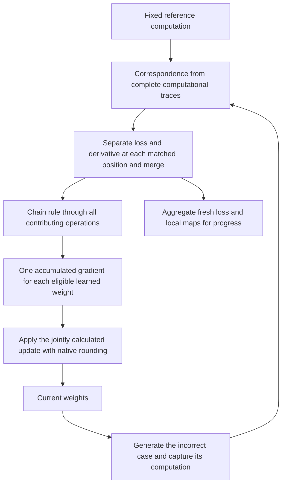

# The Final Experiment

**Current experiment.** Compare naturally generated traces across the correct and incorrect operation groups. The comparison defines the trained directions. Score signed errors there with a squared loss at every magnitude, and regenerate every declared repair and preservation case on each new weight state. Differences observed within the correct group supply allowed directions of variation. A correct trace can supply the coordinate system for registration without supplying a unique answer to imitate.

The November 17 specification below documents the earlier one-pair experiment. Its single-reference radii, directional hinges and one-prompt regeneration are historical. See the [research diary and group-overlap plan](journal/2026-11-18-trace-signal-in-the-loop.md).

Prepared November 17, 2026 (CT), at Marcos's request. This is the consolidated specification for review before the next training attempt. “Final” names the document; it does not mean the hypothesis is proved or the implementation is ready. The implementation differences and unresolved numerical choices are stated in §12. Historical runs keep their original definitions and results.

**Review status — implementation follow-through, November 17:** independent architecture, mathematics and whole-build reviews are recorded. The complete 538-parameter-array graph and mixed-precision installer are implemented. The actual-size, read-only calculation on the retained step-317 state passed; CPU integration checks cover installation and next-state use. No new native learning step has been installed. The first full-parameter run retains the measured original tolerance, including its zero cells. The unsupported positive allowance remains a research limitation, not a prerequisite to learning, following Marcos's November17 correction of the unnecessary overnight pause. Sections12–13 distinguish implemented behavior from remaining native validation; the experiment equations and tolerance policy below are unchanged.

**November 18 follow-through.** The native learner installed eleven further weight updates from checkpoint 390, using one fixed correct reference and an additional directional loss derived from two earlier successful repairs. Checkpoint 401 retained the 91 J calculation. On four new physical configurations in two orderings, neither blind reader found a new downhill repair. The [training measurements](records/development/2026-11-18-prefix-direction-training/README.md), [transfer study](studies/04-round-2-overlap/runs/prefix-direction-generalization/) and [unit of comparison](final-experiment/multiple-trace-signals.md) record the result. The November 17 implementation review above describes the state on that date.

## 1. What we are trying to establish

The broader hypothesis is that a capability leaves recurring differences between correct and incorrect computational traces, and that changing the weights responsible for those differences can repair the capability. This first training experiment deliberately tests the smaller question: **can we reliably reduce one incorrect response's full computational divergence from one selected most-correct reference, repeatedly regenerating with the updated weights?**

The selected reference is a complete, fixed original-model computation. The response we correct is regenerated from the same failing prompt after every update. Other answers are not additional training targets. An answer that ends correctly can contain incorrect intermediate computation; an outcome label does not certify every part of its trace. This experiment does not require all other outcome-correct traces to have zero loss.

The goal is to reduce freshly measured computational loss as far as learning takes it. There is no demand for exact restoration, a perfect inverse, or a loss of exactly zero. A nonzero plateau is a possible measured result, not automatically success or failure of the broader hypothesis. General capability repair and transfer require later evidence outside this one-pair fit.

**The architecture stays fixed. We change numerical values of existing learned weights.** A weight matrix is an array of those values inside an existing operation. Updating an attention-output matrix or a feed-forward matrix changes the coefficients used by that operation; it does not add, remove, replace or resize a layer. Attention probabilities and hidden activations are computed values, not the parameters we install.



## 2. Fixed inputs and their roles

| Item | Concrete binding / role |
|---|---|
| Original model | Gemma4 E2B BF16 GGUF; SHA256 `6a737131362433969a148503c92ef28cf7cf80648ac8ec74af19413a331b575c`. The original file remains read-only. |
| Reference response | `expanded-004-h1`; 560 captured computation positions, 105 residual merges per position, 1536 coordinates per merge. |
| Incorrect case | `discovery-05-channel-h1`; retain its declared prompt and acquisition settings, then generate its current response with the edited model. Its length may change. |
| Fixed reference record | `studies/04-round-2-overlap/runs/vector-chance-original/reference.json`, SHA256 `26b338685cad5fe5367c8bec91693f1e2374d6f5a836b62462924c5e44b7bee4`. |
| Reference turn array | `studies/04-round-2-overlap/runs/turn-reference-original/original-turns/expanded-004-h1.npy`, SHA256 `1b7ccbe9996af857f98d8a213fa3461e3cdd42f57906d4518f2b2f775184b2af`. |
| Starting weights for the proposed continuation | Complete stopped update 21 / historical update 317 from `vector-chance-full-weight-training`, including the FP32 rounding remainder. This is the state actually reached, not a reconstructed historical best. |
| Other saved original traces | Existing evidence used to select the reference and estimate variation. They are not regenerated, scored as additional training objectives, or differentiated during this one-pair loop. |

The historical selection procedure chose the observed successful trace with the smallest average squared turn discrepancy to the other original successful traces after computational correspondence. It selected `expanded-004-h1`. This is the recorded operational selection of the most-correct reference for this experiment; it is not independent proof that the reference contains no erroneous intermediate computation. We keep that selection fixed rather than silently choosing a new reference when training becomes difficult.

Tokens enter the model as ordinary inputs and identify positions and acquisition history. Desired words, token identity matches, parsed answers and output-text judgments do not supply the computational loss. Prompt positions are part of the causal computation and are not exempted merely because their text matches.

The concrete acquisition case is `studies/04-round-2-overlap/runs/vector-chance-loss-rise-diagnosis/reached11-complete-acquisition/cases.json`, SHA256 `6e4e5aea03e2cb8a572714c79cc00d5a477794c05909ee2debc402e1c947b754`, with prompt SHA256 `23aff2bd9cff88872faecc33c8dd1d7a47a8346933fc64ac2bf8fc60902e9dcc`. Its operational generation allowance is 1875 tokens within the existing 2048-token context; it is not a target length or a learning schedule. The observed stopped endpoint ended naturally after 440 generated tokens and supplied 612 captured computation positions. Native engine/library identity, scheduler and call settings are recorded by `loop/21/capture/capture.json`; a successor binds the actual same acquisition implementation and all intended changes before it runs.

## 3. The computation we trace

### 3.1 Architecture and notation

The actual model has **35 transformer blocks**, indexed `l = 0…34`, with a residual width of **1536**. Each block has three recorded residual merges:

1. attention branch added to its residual input;
2. feed-forward branch added to that result;
3. per-layer-input branch added to that result.

Thus there are **105 measured merges**, `m = 3l + b`, where `b = 0,1,2`. These are 105 measurement sites within 35 blocks, not 105 independent trainable models. All merges at all captured positions enter the comparison.

The fixed architecture also includes embeddings, normalization, positional rotation, causal attention, key/value reuse, nonlinearities, per-layer input features, layer output scales, and the output computation that generates the next token. A measured merge's derivative must follow its dependencies through those operations even where an operation has no separate trace-loss term.

| Architecture property | Actual model |
|---|---|
| Query heads / key-value heads | 8 / 1 |
| Global attention blocks | 4, 9, 14, 19, 24, 29, 34 |
| Remaining attention blocks | Sliding-window attention, window 512 |
| Head width | 256 for windowed blocks; 512 for global blocks |
| Feed-forward hidden width | 6144 for blocks 0–14; 12288 for blocks 15–34 |
| Per-layer-input width | 256 |
| KV production | Blocks 0–14 produce their own K/V; later windowed blocks reuse block 13, later global blocks reuse block 14 |
| RoPE base | 10,000 windowed; 1,000,000 global, with the stored global frequency factors |
| Normalization epsilon | Model metadata approximately `1e-6`; reconstruction uses `1e-6` |
| Output logits | Final normalization, tied output projection, softcap 30, then the declared generation rule |

The architecture source is `studies/04-round-2-overlap/runs/functional-layout-original/source-records/architecture.json`; the reconstructed operation order is in `records/development/2026-11-12-path-forward/torch_forward.py`. Shapes and dtypes must come from the actual tensor inventory. For example, resident attention-output matrices are `1536 × 2048` in a windowed block and `1536 × 4096` in a global block; feed-forward-down matrices are `1536 × 6144` or `1536 × 12288`. A single illustrative shape from an older paper is not the inventory.

### 3.2 How inputs become outputs inside a block

Let `x[l,t]` be the residual input at block `l`, computation position `t`. Let `N_g(v)` denote the model's RMS normalization with its stored scale values and epsilon. Matrix notation below uses column vectors; resident implementation layouts may be transposed.

The reconstruction uses `N_g(v) = g ⊙ v / sqrt(mean(v²) + ε)`, with no learned `g` for the value-only RMS normalization. Its GGML-compatible GELU expression is `0.5 v [1 + tanh(sqrt(2/π) v (1 + 0.044715 v²))]`. These are existing architecture operations/constants from `torch_forward.py`, not newly chosen hyperparameters. RoPE rotates paired coordinates `(a, a + head_width/2)` by `position × base^(-2a/head_width) / frequency_factor`; the local factor is one, and the global factors are the fixed buffer described in §7.

**Embedding and per-layer inputs.** The token embedding and its native scaling produce the initial residual stream. A second embedding table supplies a 256-coordinate feature for each block. The per-layer feature also includes the normalized shared projection of the initial residual stream. In the current reconstruction, the table component is scaled by `sqrt(256)`, the shared projection by `1/sqrt(1536)`, and their sum by `1/sqrt(2)`. These factors belong to the fixed forward computation, not tunable loss weights.

```text
x[0,t] = sqrt(1536) × E_token[token_t]
shared[t,:,:] = reshape(W_shared x[0,t] / sqrt(1536), [35,256])
p[l,t] = (N_shared(shared[t,l,:]) + sqrt(256) × E_per_layer[token_t,l,:]) / sqrt(2)
```

The shared projection's scaling precedes its normalization. Native anchoring/rounding is applied as described in §8; it must retain the derivative through these inputs when the embedding/projection weights become eligible.

**Attention.** Normalize the block input, form queries and the relevant producer's keys/values, apply the model's query/key normalization and positional rotations, then compute masked attention over available causal positions:

```text
u_t = N_attn(x[l,t])
q_t = RoPE(N_q(W_q u_t))
k_s = RoPE(N_k(W_k u_s))           at the actual KV-producing block
v_s = RMS(W_v u_s)                 at the actual KV-producing block
a_ts = softmax_s(native_score(q_t, k_s) + causal/window mask)
context_t = concatenate_heads(sum_s a_ts v_s)
attention_t = N_post_attention(W_attention_output context_t)
y[l,t,0] = x[l,t] + attention_t
```

The current reconstruction's `native_score(q,k)` is `qᵀk` using the stored query/key normalization weights, with no additional generic `1/sqrt(head_width)` inserted from another transformer. Its exact finite native arithmetic remains subject to §8. KV reuse is part of the dependency graph: loss at a late consuming block can differentiate back into the earlier producer's weights and positions. Captured caches cannot simply be treated as constants for those routes.

**Feed-forward computation.** Its two input projections and gated nonlinearity both contribute:

```text
f_t = N_ffn(y[l,t,0])
z_t = GELU(W_gate f_t) ⊙ (W_up f_t)
feed_forward_t = N_post_ffn(W_down z_t)
y[l,t,1] = y[l,t,0] + feed_forward_t
```

**Per-layer-input computation.** With the corresponding feature `p[l,t]` from the embedding/shared-projection path:

```text
z'_t = GELU(W_input_gate y[l,t,1]) ⊙ p[l,t]
per_layer_t = N_post(W_projection z'_t)
y[l,t,2] = y[l,t,1] + per_layer_t
x[l+1,t] = layer_output_scale[l] × y[l,t,2]
```

The final scale is after the third measured merge. Scales in blocks 0–33 affect later measured merges; the last block's scale and final output normalization affect output generation after the last measured merge. Their distinction matters when stating which derivative the loss actually supplies.

The concrete model's normalization conventions, GELU variant, reshape/head layout, native rounding and call geometry must be preserved by the differentiated reconstruction. The equations show dependencies; they do not authorize replacing native operations with a merely similar architecture.

### 3.3 The trace observable

At each merge, retain its own incoming vector `h_in` and outgoing vector `h_out`. Define:

\[
u(v)=v/\|v\|_2,\qquad T_{t,l,b}=u(h^{out}_{t,l,b})-u(h^{in}_{t,l,b}).
\]

The three input-output pairs are `(x,y0)`, `(y0,y1)`, and `(y1,y2)`. The complete response trace is the ordered array `T[t,l,b,:]`, together with the computational dependencies and acquisition provenance that produced it.

This measures the **change in normalized residual direction caused by a merge in its actual context**. Its vector and vector length are retained. The loss does not normalize `T` itself. It does not replace the trace with `h_out` or a desired token. However, normalizing `h_in` and `h_out` means this observable does not identify every absolute activation scale or uniquely determine every internal operation. We must not describe equality of these turns as equality of all possible computations. Raw norms and branch/call records remain useful diagnostics.

Zero or nonfinite normalization inputs are invalid observations; they are reported rather than silently replaced. All actual captured prompt and generated computation positions are included. A sampled terminal token that is never consumed by a forward pass has no additional hidden-state computation to invent; event IDs follow native capture, not a presumed equality between text length and captured row count.

## 4. How the two traces correspond

The responses can differ in length and wording. Position `t` in one response is therefore not automatically the counterpart of position `t` in the other.

For correspondence only, flatten each position's full `105 × 1536` turn field and normalize that flattened vector. Compute pairwise cosine similarity between reference and current positions. The existing dynamic-time-warping procedure chooses a monotonic, full-coverage path with local cost `1 − cosine`, fixed start/end points, and deterministic diagonal/vertical/horizontal tie order. The output is a list of pairs `P = {(i,j)}`, where `i` is a reference position and `j` a current position.

If a flattened turn field has zero norm or nonfinite entries, its cosine is undefined even when each underlying residual vector is nonzero. Keep the existing explicit measurement failure for that case; do not invent an epsilon, artificial direction or match.

Every reference and current position is represented. A position can have multiple matches; the weighting below accounts for that. Token equality, prompt identity, word anchors, selected error words and a chosen narrow stretch do not determine these pairs.

The correspondence is **held fixed during one gradient calculation**. After installing an update and generating again, it is recomputed from the fresh trace. We do not differentiate through the discrete DTW choice or discrete token generation. The derivative is conditional on the current acquisition and correspondence, not an exact derivative of the entire generated-response distribution.

The alignment cost and training loss differ: alignment uses flattened cosine; loss uses local turn-vector distance and tolerance. This is an explicit retained construction, not a claim that DTW certifies causal equivalence or that a shorter response necessarily performed every reference computation. Save the actual pairs and multiplicities so a reduction caused by changed matching can be distinguished from a reduction in an existing local discrepancy.

## 5. Local divergence and tolerance

For each matched pair `(i,j)`, block `l` and branch `b`, with `m=3l+b`:

\[
\delta_{ijm}=T^{current}_{jm}-T^{ref}_{im},\quad
d_{ijm}=\|\delta_{ijm}\|_2,\quad
e_{ijm}=\max(d_{ijm}-\tau_{im},0),\quad
\ell_{ijm}=e_{ijm}^2.
\]

**This is a separate loss at every matched position and every merge.** There is no preliminary selection of the farthest divergence and no global error copied back onto all positions. A small local excess supplies a small local trace derivative; an in-tolerance cell supplies zero direct loss derivative.

Tolerance means permitted computational movement around the fixed reference. It is not a requirement to return exactly to the original trajectory. An in-tolerance cell can move because it shares weights with other positions; zero direct loss does not freeze those weights or guarantee the cell stays inside tolerance after a finite update. The next fresh measurement observes that movement.

### Existing tolerance and the unresolved zero-radius case

The stopped run uses a frozen scalar `C[i,m]` derived from original observations:

\[
C_{im}=\frac{1}{K}\sum_{a=1}^{K}\frac{1}{|J_a(i)|}
\sum_{j\in J_a(i)}\|T^a_{jm}-T^{ref}_{im}\|_2^2,
\qquad \tau_{im}=\sqrt{2C_{im}},\quad K=14.
\]

Here the fourteen original nonself witnesses supply **variation calibration**, not fourteen extra current losses or certified error-free labels. The resulting ball is isotropic. The factor two is the existing declared adaptation; it is not a statistical confidence guarantee for an individual computation. Calibration and reference stay fixed during training and never absorb edited-model drift.

There is a concrete mismatch to resolve before claiming the next run implements tolerance everywhere: **1,365 cells have exactly zero `C`, covering all 105 merges at reference positions 0–12.** Identical observed calibration values explain the zeros, but do not establish that every later movement is harmful. The current code assigns these cells exact turn equality as their zero-loss set. That is narrower than Marcos's intended permitted movement.

The reason to change those point targets is **Marcos's earlier clarification in this conversation that tolerance should permit collateral movement of already-agreeing computation when shared weights are updated**, carried into his November 17 request for this consolidated experiment. It is not a mathematical consequence of allowing a nonzero final aggregate loss, nor an arithmetic bug in the old radial formula.

**Restart correction, November17:** For the first full-parameter learning run, retain the exact original immutable chance array and its zero cells. Marcos's instruction was to carry the work through to actual training progress; root incorrectly turned the unresolved positive allowance into an overnight prerequisite. The existing calibration is measured and already supports learning, so no new allowance is invented or silently fitted. The zero-radius cells remain visible in local loss records, and exact-zero loss is not a required stopping condition. A separately supported positive movement allowance remains future research work, not a block on this run. Numerical reproducibility measures numerical noise, not all acceptable semantic variation.

Any replacement allowance is a **new immutable tolerance artifact and loss version** around the same selected reference turns. Bind its derivation and make the residual, outside flag, local map and declaration consume that same artifact. Preserve the existing reference/calibration hashes. Historical loss numbers remain attached to their old definition; they do not become comparable new-definition losses by relabeling.

## 6. Aggregating losses without broadcasting one error

Let `R` be the number of reference positions, `M=105`, and `n_i` the number of pairs in `P` that contain reference position `i`. The retained integration rule is:

\[
w_{ijm}=\frac{1}{RMn_i},\qquad
L=\sum_{(i,j)\in P}\sum_{m=0}^{M-1}w_{ijm}\ell_{ijm}.
\]

Each reference position/merge has total mass `1/(RM)`, divided across its matches. The weights sum to one. This is a mean of **already separate local squared excesses**, with explicit correspondence mass. It is not squared mean divergence, maximum divergence, or equal mass per current position.

Equivalently, define a vector residual:

\[
r_{ijm}=\sqrt{w_{ijm}}\max\left(1-\frac{\tau_{im}}{d_{ijm}},0\right)\delta_{ijm},
\qquad L=\sum\|r_{ijm}\|_2^2.
\]

For `d=0`, use the continuous zero-loss case without division. At zero radius the existing residual is `sqrt(w) δ`, including its Jacobian at zero; this describes the historical rule, not a resolution of the tolerance issue above.

For a positive excess, the local derivative is:

\[
\frac{\partial L}{\partial T^{current}_{jm}}\Big|_{(i,j,m)}
=2w_{ijm}\left(1-\frac{\tau_{im}}{d_{ijm}}\right)\delta_{ijm}.
\]

It is zero inside and at the positive-radius boundary. Contributions sum when the same current position is matched more than once. The shrink factor is differentiated as part of the residual calculation; it is not detached and treated as an unrelated multiplier.

**Small illustration.** Two scalar local deviations of 1 and 4, zero tolerance and weights `1/2`, have local squared losses 1 and 16 and aggregate loss 8.5. Their derivatives are **1 and 4**. Neither position receives a derivative of 8.5 or 16. Computing one aggregate differentiable scalar is normal backpropagation; erasing local residuals before differentiation or broadcasting one error would be wrong.

This fixes the allocation of the **local trace error**, but does not guarantee every local loss decreases together. Shared weights receive contributions from several cells, and their computational Jacobians can have different sensitivities or conflicting directions. A finite common step can therefore increase some local losses even with correctly formed local derivatives. That is why the local maps, actual native response and justified step size remain part of the experiment; a falling aggregate alone cannot establish that an early, smaller divergence was not overcorrected.

The recorded map must retain `(i,j,l,b)`, local distance, tolerance, excess and weighted squared loss. A per-current-position/per-block view sums only that position's matched contributions and its three branches. A reference-position view sums only the corresponding reference contributions. Both sum back to the same `L`; neither substitutes for the pair-level record.

This mass convention has a limitation: more low-error matches can dilute the average assigned to a reference position even if one high-error match remains. Record multiplicity and local tails alongside the aggregate. Do not infer that every local computation improved just because `L` fell.

## 7. From computational gradients to individual weight gradients

The computational derivative above is **not** the numerical update to a weight. The chain rule supplies the conversion. For every eligible learned tensor `W_k`:

\[
g_k=\frac{\partial L}{\partial W_k}
=\sum_{(i,j),m}
\left(\frac{\partial T^{current}_{jm}}{\partial W_k}\right)^\top
\frac{\partial (w_{ijm}\ell_{ijm})}{\partial T^{current}_{jm}}.
\]

For nonzero `v`, the normalization Jacobian is:

\[
D u(v)=\frac{I-u(v)u(v)^\top}{\|v\|_2}.
\]

Thus a turn differentiates through **both** its output and input, with opposite signs, and then through every causally connected operation that produced them. Both edges matter. Treating the input as frozen, applying a turn-coordinate error directly to a matrix, or independently asking each matrix to supply the whole missing correction changes the problem.

For a linear operation `y=Wx`, an incoming derivative `c=∂L/∂y` gives `∂L/∂W = c xᵀ` and `∂L/∂x = Wᵀc`. Across positions these contributions accumulate into the **same** weight tensor. The downstream derivative `c` already contains the effects of the subsequent normalization, nonlinearities, merges, attention and trace loss. It is not the raw trace discrepancy pasted into that formula.

Learned normalization gains and layer scales receive derivatives through their actual normalization/multiplication operations; they are not forced into a matrix-only update formula. Embedding gathers accumulate derivatives back into shared table rows, adding repeated occurrences. The saved reference turns, tolerance and fixed-within-step correspondence weights are constants in this differentiation.

Attention connects positions; later losses can affect earlier K/V production. Depth connects blocks; later losses can affect earlier transformations. Each weight's total derivative includes all of its causal uses at the same current weight state. There is no separate model copy or independent set of weights per token.

Use `a` for a tensor index and `s` for a training iteration: compute all derivatives at the whole parameter collection `W^(s) = {W_a^(s)}`, then apply one joint update to obtain `W^(s+1)`. Processing derivatives in memory-sized chunks is acceptable if it preserves this same-state derivative and all dependencies. Updating early weights while still computing later derivatives from stale activations is a different sequential procedure and is not specified here.

### Intended parameter scope

The proposal is to make **every learned parameter that contributes continuously to the measured trace eligible for differentiation**, with explicit explanations for parameters outside that graph. Every tensor need not have a nonzero gradient, and every scalar entry need not change on every update. A true zero derivative, an unused embedding row, a frozen parameter and an accidentally detached dependency are different cases.

The inventory must cover:

- token and per-layer embedding tables, including shared/tied uses;
- shared projection and normalization that produce per-layer inputs;
- query weights and query normalization in every block;
- the actual key/value producer weights and key normalization, following reuse rather than pretending all stored K/V tensors execute;
- attention-output weights and attention pre/post normalization;
- feed-forward gate, up and down weights and their normalizations;
- per-layer-input gate and output projection weights and their normalization;
- layer output scales wherever they lead to a later measured merge.

The frozen architecture includes masks, connectivity, dimensions, positional rules and fixed constants. A tensor whose name ends in `.weight` is not automatically a learned parameter: **`rope_freqs.weight` is a fixed generated buffer**, constructed from `partial_rotary_factor` as ones for rotated dimensions and `1e30` for unrotated dimensions by `Gemma4Model.generate_extra_tensors` in the native converter's `conversion/gemma.py`. Its stored name does not make it trainable.

The source inventory is **601 stored tensors = 538 learned tensors with continuous paths to measured turns + 60 unused late K/V/K-normalization tensors + two output-side tensors beyond the measured final merge + one fixed rotary buffer**. The 538 eligible learned tensors are accounted for below. Eligibility does not assert a nonzero derivative at every use or entry.

| Learned tensor families with a path into the measured turns | Tensor count |
|---|---:|
| Token embedding and per-layer embedding | 2 |
| Shared per-layer-input projection and normalization | 2 |
| Query projection and query normalization in 35 blocks | 70 |
| Key/value projection and key normalization in 15 producing blocks | 45 |
| Attention-output projection, attention input normalization, post-attention normalization | 105 |
| Feed-forward gate, up, down, input normalization and post-feed-forward normalization | 175 |
| Per-layer-input gate, output projection and post normalization | 105 |
| Layer output scales before later measured merges, blocks 0–33 | 34 |
| **Total** | **538** |

The stopped trainer targeted only 70 tensors: 35 attention-output and 35 feed-forward-down matrices. **468 other eligible learned tensors were excluded before automatic differentiation.** We cannot present that as complete parameter coverage. The stopped trainer's embedding reader loaded rows from its working GGUF outside the candidate/automatic-differentiation leaf mapping. It could see installed table bytes on later reads, but adding table names to a trainable list alone did not supply the missing derivative or candidate/dual-weight path. The successor now implements shared sparse leaves and the candidate/dual-weight path for those rows. Sparse accumulation for actually used embedding rows is valid because unaccessed rows have zero derivative for this conditional trace objective; silently freezing accessed rows is not.

The complete eligible storage inventory is **278 BF16 tensors and 260 FP32 tensors**. The stopped trainer's installation code rejected the FP32 case, and its shared per-layer-input projection sat outside the projection interception path. The successor now implements the FP32 recurrence and shared-projection derivative route, with an explicit native arithmetic policy and the qualification limits in§8 and§13. These changes update existing weights within the fixed architecture.

The final output normalization and final block scale have no continuous path back into the already measured turns on a held token history. Their effects through future discrete token choices are not differentiated by this objective. They remain explicitly outside this conditional derivative. The tied embedding/output matrix is eligible through its input-embedding use; its output-sampling use does not acquire an invented derivative. This limitation is recorded rather than hidden by a claim to train literally every stored tensor.

## 8. Native arithmetic, step size and installation

### 8.1 What derivative is actually available

The native model uses finite precision. The current implementation reconstructs the connected computation, anchors forward values to native captures, and uses differentiable surrogates through rounding. The `NativeGraph` construction uses native anchors plus the difference between the current and frozen reconstructed functions. Matching the native value at the current point does **not** prove that its derivative predicts a finite native update.

The current BF16/FP16 straight-through rules are therefore derivative estimators. They have known finite-response discrepancies. They are not the exact mathematical derivative of the discrete stored-weight/native execution mapping, and the document does not call them exact. The broader learned-parameter scope must preserve each newly included route and native dtype, not merely set additional `requires_grad` flags on the old 70-tensor installer.

### 8.2 Direction and response-derived length

Use the joint weight gradient to form `S=-g`. Concatenate the weighted vector residuals conceptually into `r`, and calculate the directional derivative `q=J_r S` through the same graph. The linearized squared residual along this direction has the stationary length:

\[
\alpha=-\frac{\langle r,q\rangle}{\langle q,q\rangle},\qquad
\Delta W=\eta\alpha S.
\]

This is one directional calculation, not an inner search for a perfect correction. It does not guarantee a finite native decrease. A zero denominator, nonfinite result, zero gradient or inconsistent descent sign is a diagnostic to report, not an excuse to manufacture a large step or claim convergence. At positive-radius boundaries the residual's directional behavior is piecewise; its AD branch is another limit on the prediction.

The stopped run's empirical learning multiplier is `η = 0.26989262219171917`, derived as `sqrt(9.48412255457209e-9 / 1.3020124340733788e-7)`. The numerator is the squared JVP residual response to the actual rounded BF16 displacement; the denominator is the measured squared finite native residual change in the earlier comparison. They are `anchored_actual_bf16_jvp.curvature` and `total.finite_squared_residual_change` in `studies/04-round-2-overlap/runs/vector-chance-loss-rise-diagnosis/native-first-bad/residual-decomposition.json`; the prescribed use is recorded in the sibling `per-merge-response/README.md`.

**Proposed next-attempt rule: retain that measured eta as the initial fixed multiplier and recompute alpha from the complete new residual/gradient each step.** The reason is to retain the available measured gain correction while directly testing the enlarged gradient scope, instead of inventing another constant or introducing a perfect-step search. This is an explicit experimental transfer of an empirical multiplier, not a qualification of its safety in the new parameterization. A change in eta would be separately recorded with its evidence; there is no automatic halving or guessed schedule. The fresh result, not the old calibration, determines how the broader update actually behaved.

### 8.3 Preserve native storage precision and small updates

For each eligible tensor `a` at iteration `s`, use its actual native storage conversion `Q_a`, and retain an FP32 wanted-minus-stored remainder `E_a`. Conceptually:

\[
U_a=W_a^{(s)}+E_a^{(s)}+\Delta W_a,\quad
W_a^{(s+1)}=Q_a(U_a),\quad
E_a^{(s+1)}=U_a-\operatorname{float}(W_a^{(s+1)}).
\]

The concrete proposed arithmetic is dtype-specific. Let `λ = ηα`, and let `f32`/`f64` denote an explicit cast. Evaluate each array chunk in the stated addition order, preserving a single source state:

```text
U64 = f64(W_current)
U64 = U64 + f64(E_current)
U64 = U64 + (f64(S) × λ)

For a BF16 native tensor (preserve the existing arithmetic):
    wanted32 = f32(U64)
    W_next = existing_native_BF16_round(wanted32)
    E_next = f32(wanted32 - f32(W_next))

For an F32 native tensor (proposed extension):
    W_next = f32(U64)
    E_next = f32(U64 - f64(W_next))
```

The F32 extension forms its remainder **before discarding the F64 wanted value**; otherwise an F32-to-F32 storage conversion would leave an identically zero remainder. This proposal retains sub-F32 rounding residuals to the precision of these operations; it does not promise exact real arithmetic or accumulation below F64 resolution. BF16 behavior and the existing 70 remainders are unchanged. The extension is now implemented in full_state.py, with arithmetic, exact native conversion, finite-value failure and recovery checks; the actual-size qualification exercised its read-only preview. Installation and subsequent fresh generation with all538 tensors remain untested at native model size.

The remainder allows small requested updates to accumulate instead of disappearing on every BF16 write. It is not an extra reference or a second training model. For the broader inventory, some native tensors have different storage types; all must follow their own real layout and dtype. A BF16-only matrix installer is insufficient for that promise.

On the proposed continuation, preserve the stopped run's existing 70 native tensor states and all 70 carried remainders exactly. The newly eligible tensors begin with their actual current native values and zero previous-update remainder because that run never updated them. This extends the state; it does not reset the previous learning or pretend an old 538-tensor optimizer checkpoint existed. Sparse embedding state must preserve repeated and subsequently encountered rows without creating independent copies of tied parameters.

Complete the joint installation into the resident native model and the derivative model before any fresh generation. Clear acquisition caches so no old history/KV values survive into a new rollout. Record the complete transition identity; a partial installation is not a trainable next state. Keep one working native model. Save complete recovery state at deliberate handoffs/stops, with compact per-step records where useful; do not copy the full model at each layer or iteration.

### 8.4 Account for the displacement actually installed

Carried remainders and native rounding mean the installed displacement is generally different from `ηαS`. Retain the existing second directional calculation at the same source weights, history and correspondence:

```text
D_native = float(W_next) - float(W_current)
q_installed = J_r D_native
predicted_loss_for_installed_step = ||r + q_installed||²
```

The coefficient of `D_native` is **one**. Do not rescale the installed step using another fitted optimum from this diagnostic. Keep the native endpoint bytes and the numerical precision of the displacement calculation explicit; if its cast into the JVP dtype loses information, record that approximation rather than calling the direction byte-exact.

This is still a **surrogate prediction for the realized displacement**, not a native measured response. Distinguish it from the continuous-direction prediction and from the next fresh native loss. If generation history or correspondence changes, the fresh-versus-predicted difference includes those changes; it does not isolate derivative error alone. No second-answer evaluation or extra native probe is introduced by retaining this already existing JVP.

## 9. The training loop

```text
Bind the selected reference, supported tolerance and original acquisition protocol.
Restore the complete starting native weights and matching rounding remainder.
Inventory the actual eligible learned parameters and all forward dependencies.

Generate the incorrect case from its prompt with the current native weights.
Capture its complete naturally ended computation and all 105 merges.

Repeat:
    Recompute full computational correspondence to the fixed reference.
    Calculate every local distance, excess, weighted residual and local loss.
    Aggregate those differentiable losses into L; preserve the local map.
    Backpropagate through the connected computation into every eligible weight.
    Calculate one response-scaled step using the declared learning-rate rule.
    Install the complete update and update all rounding remainders.
    Reset acquisition caches and generate again from the updated native model.
    Capture, realign and measure the complete fresh path.
    Record actual local and aggregate changes; judge whether learning continues.

At a deliberate stop, save complete weights, remainders and last fresh measurement.
```

The reference is never regenerated from the edited model. The current response is never replayed from an old model and passed off as fresh. A held-history calculation is explicitly labeled as such; it does not replace the fresh rollout. Every model revision used for prediction, installation, capture and measurement is linked.

The declared context/acquisition limit is operational, not a target response length. A truncated, incomplete or nonfinite trace is not a lower-loss success. No extra position is invented to complete its shape, and no missing layer is assigned zero loss.

## 10. Progress, stopping and what a result means

Use **fresh native computational loss** as the main learning curve, with the original-model baseline, the current continuation baseline and the best observed value on the same definition. Show the local maps and response diagnostics beside it so a scalar reduction cannot conceal what happened.

Every curve carries the reference, tolerance and loss-definition identity. After a tolerance change, show the old curve as historical and begin the new curve with its own baseline; recompute older points only where sufficient retained data support the new score. Do not invent a new-definition score for historical 203 or compare a new-tolerance endpoint with its old-tolerance minimum as if they shared a scale.

There is no guessed target such as `1e-6`, required percentage improvement or fixed training duration. Continue while the evidence supports learning; allow finite-step variation without calling every rise a proof of a code bug. A sustained rise, repeated failure to predict native movement, new local damage or a plateau calls for a cause-based review of the recorded update, not blind continuation or a new reference chosen to improve the number.

Research judgment decides whether improvement has genuinely stalled from the actual sequence, with no invented automatic plateau threshold. Report the reached nonzero residual when that happens. Exact `L=0` means only that the represented matched turns lie inside the declared tolerance; it is not an independent proof of general capability repair. Conversely, nonzero `L` does not erase demonstrated progress.

One-pair improvement supports this first experiment. Broader recurrence, preservation on other computations and transfer need a later, separately frozen evaluation. The sealed data and no-fit cases remain outside training, calibration and model selection now.

## 11. What must be visible in the records and MLflow

Use the existing Recorder/exporter rather than adding network work to the solver. The native records are the measurement source; MLflow presents them. Keep the existing primary fresh-loss metric **`native.objective`** stable, and separate it from predicted or held-history losses.

| Record / view | What it answers |
|---|---|
| Fresh aggregate loss and baseline/best/current | Is the current model's measured computational divergence falling? |
| Complete `(reference position, current position, block, branch)` local map | Where is the divergence, how large is each local excess, and what moved? |
| Current-position × block and reference-position × block heatmaps | Do early/late or small/large discrepancies improve differently? |
| Fixed-reference and current trace overlay with saved correspondence | Which computations are compared, where do they depart, and is the gap closing? |
| Raw distance, tolerance and outside status | Did a cell improve, cross tolerance, or move within its permitted range? |
| Correspondence multiplicities / changed pairs | Did changed registration or dilution contribute to the scalar change? |
| Gradient and actual-update inventory for every eligible tensor | Was it differentiated, disconnected, zero, rounded away, or actually changed? |
| Per-merge continuous-direction prediction, actual-displacement surrogate prediction, and fresh native loss | How do requested and installed updates predict movement, and what did the new native computation actually do? Changed history/pairs remain visible. |
| Step size, native dtype, rounded displacement and remainder | What update was requested and what was installed? |
| Acquisition and model identities, completion and timing | Did the next measurement use the new weights and a complete fresh path? |

The stopped70-array implementation recorded a `560 × 105` reference-aggregated weighted-loss map and105 per-merge response terms. The successor now implements the complete pair-level/current-position maps and538-array inventory with CPU plotting and reconciliation checks. Those prospective records are not a claim that a new full-parameter native learning step has been captured.

Detailed numeric maps remain local artifacts with explicit provenance and can be published as appropriately sized summaries/plots. Do not upload raw model weights or full hidden-state arrays to MLflow. Checkpoints and expensive captures follow the existing verified R2 archive procedure, with no release of an in-use or unverified only copy. Log absent historical fields as absent, not reconstructed observations.

## 12. Implementation comparison and decisions before retry

The source audits found no broadcast of the maximum loss, sign error, lost mass factor or missing chain-rule factor in the current selected-parameter loss. That finding does not establish parameter completeness, reference perfection or native derivative fidelity.

| Piece | Implemented and checked | Remaining evidence or decision |
|---|---|---|
| Selected pair and fixed reference | Same selected pair, fixed reference, only the wrong case regenerated | Preserve these bindings in the eventual learning declaration |
| Full105-merge trace and local losses | Both normalization edges differentiated; full local residuals before aggregation; actual612-position graph passed | Measure the next complete fresh path after installation |
| Tolerance | Historical radial field reproduced exactly, including1,365 zero-radius cells | Retain the exact historical calibration for this run; positive allowance remains unsupported and explicitly unresolved |
| Parameter scope | Physical inventory601;538 eligible learned arrays; every eligible array has a finite nonzero gradient in the retained-state check | Parameter count and connectivity do not establish repair |
| Native fidelity | Three exact native-origin checks and both105-merge JVP tables completed | Surrogate derivatives remain approximate; compare with actual finite native response |
| Step size | Full-scope response-derived alpha and the retained empirical eta are implemented | Initial eta transfer remains an experimental assumption, not a stability guarantee |
| Native installation |278 BF16/260 F32 layouts supported; all538 typed previews completed; CPU integration checks verify installation and subsequent reads | Actual-size joint installation and next native generation remain untested |
| Recovery/storage | Old70 remainders retained; complete expanded checkpoints and sparse/dormant rows implemented and CPU-tested; no per-step full copies | New persistent remainder allocation and full native lifecycle memory remain unmeasured |
| Source binding | Actual successor reader/helpers and changed sources are bound; historical executed capture source is preserved by exact hash | Bind the final prospective versions when the learning run is declared |
| Error cleanup | Generator closure and candidate-map restoration corrected and tested | Preserve cleanup in the admitted source version |
| Observability | Complete local maps and inventory; prospective GPU-worker logging context checked on a small CUDA fixture | Historical65 orphaned detail spans remain disclosed; no new full-model trace with the fix is claimed |
| Research status | Read-only actual-size calculation passed; original step317 loss reproduced | No new fresh-loss decrease, convergence or repair result follows from that check |


This document does not silently amend historical declarations, launch the next run, apply the pending retired-entrypoint cleanup patch, or widen the research scope. It makes the intended computation and remaining implementation/numerical decisions concrete enough to review. The next attempt follows review of this specification and the code that actually implements it.

## 13. Review and current execution state

The independent [architecture and parameter review](records/retrospectives/2026-11-17-final-experiment-architecture-review.md), commit `711103f8`, supports the 35-block/105-merge anatomy and the 538-learned-tensor scope within unchanged architecture. It found the implementation incomplete at the original specification review; the subsequent implementation evidence is recorded below. This document incorporates its fixed-buffer classification, 278 BF16/260 FP32 accounting, working-file embedding clarification, missing shared-projection route and continuation-state requirements.

The independent [mathematics and complete-loop review](records/retrospectives/2026-11-17-final-experiment-math-review.md), initial commit `c1ddde81` and revision addendum `2f3898dc`, finds the local loss, aggregation, normalization derivatives, shared-weight chain rule and response-derived length internally sound. Its addendum confirms the proposed FP32 recurrence is consistent and preserves the old BF16 recurrence. This document incorporates its installed-displacement JVP, loss-version comparability, tolerance-policy attribution, explicit arithmetic/initialization, undefined-cosine handling and iteration-notation corrections. The initial eta choice is concrete and explicitly empirical. Those initial findings concern the source/specification, not a native training result. The later whole-build review covers the broader implementation.

Both initial reviewers read the four baseline documents and the implementation appropriate to their review. The independent whole-build review also reads all four documents and covers the implemented trace, reference, loss, derivative, installation, regeneration and stopping. Its retained-result assessment supports PASS for the admitted actual-size, read-only scope:538 connected finite nonzero tensor gradients, one VJP, two JVPs, three exact native-origin checks and historical loss reproduced exactly. No learning update or new generation occurred. The result, source versions, resource incident and limits are preserved in `runs/vector-chance-final-graph-qualification-2/` and `records/retrospectives/2026-11-17-final-experiment-build-eli.{md,json}`.

The implementation record is `records/development/2026-11-17-final-experiment/implementation.md`. Twenty-two state CPU tests and five controller integration tests pass after the independently reviewed allocation reduction. The actual-size preview took570.043s during severe shared-host memory pressure; no post-fix speedup is claimed. GPU allocation peaked at4.742GB and processRSS at31.413GB, with a separate9.311GB private native descriptor payload; these do not constitute a complete-system peak or a safe budget for the untested post-installation lifecycle. The original calibration is retained for the first full-parameter learning run, following the restart correction in§5; no positive allowance or changed mathematical loss is claimed.

The preceding run stopped normally at **02:30:14 CT on November 17**, after **21 complete updates** from historical 296, reaching historical **317**. Its final fresh loss is **0.00006447133821394787**, from continuation baseline **0.00006569697680377648**. The native weight state and FP32 remainder are complete, with no pending installation or transition. This is an intentional review pause, not a plateau or convergence verdict. The service is inactive. No successor learning run was started.

Checkpoint and measurement: `studies/04-round-2-overlap/runs/vector-chance-full-weight-training/final-state.json`, `launcher-exit.json`, `loop/21/measurement.json`. The original-model loss under this definition was `0.00029234223350039747`; the lower historical observed value at 203 was `0.00004162763526526834`, but its exact weight/remainder state is not retained and is not fabricated here.

## 14. Sources and precedence

Marcos's November 17 request and selected-pair/weights-versus-architecture clarifications determine this document's scope. The relevant interpretation records are `journal/2026-11-17-one-pair-scope-correction.md`, `journal/2026-11-16-direct-computational-update.md`, `journal/2026-11-16-loss-improvement-goal.md`, and the November 7 hypothesis clarifications named by `STATE.md`.

All four baseline documents were read directly, including their equations. Their earlier construction choices are evidence, not automatic requirements for this revised experiment:

| Baseline document | SHA256 | What it contributes |
|---|---|---|
| `reports/fixing-a-reasoning-mistake-by-editing-the-weights.pdf` | `a5761c87f7760d13cfe38d754fb8d0921460fc85f2a4b00ffd4bceb33d81e080` | Useful computational fragments and persistent weight edits; local effects can differ downstream |
| `reports/how-the-trace-derived-edit-works.pdf` | `10de7506371d4bc40f0c3dd255d450c60a949891513e5050e58870a9bda91410` | Input-output turns, operation-specific derivatives, and limitations of selected-position correction |
| `reports/how-the-path-edit-works.pdf` | `fced267c17a61c5da09fe9bb2b0fe4cabb618fbbd2a8542c4c64e38be76aacc2` | Computational correspondence, variation, joint effects, downstream dependencies and native precision |
| `reports/Iterative_Learning_from_Computational_Traces.docx` | `71cc3dfcfbf386898f706c571ad5539ef2f20629e510abc5710b003d2eb07149` | Repeated fixed-reference learning, local excess, coordinated derivatives and current-model regeneration |

Source-level audits: `records/retrospectives/2026-11-17-reference-correspondence-review.md`, `2026-11-17-loss-semantics-code-review.md`, and `2026-11-17-executed-training-code-review.md`. The corrected witness interpretation in those records takes precedence over their withdrawn earlier diagnosis.

Key implementation sources: `code/signal-trace/pipeline/overlap/complete_overlap.py`; `code/signal-trace/pipeline/weight_edit/{turn_pair,vector_chance,trace_gradient,trace_response,native_graph}.py`; `records/development/2026-11-12-path-forward/torch_forward.py`; `records/development/2026-11-17-full-weight-training/{run,capture}.py`. The stopped run's `declaration.json` binds the executed source versions. The successor adds `code/signal-trace/pipeline/weight_edit/{full_parameters,full_graph,full_state,full_loss_maps}.py` and `records/development/2026-11-17-final-experiment/{run,capture,archive}.py`. The next declaration binds its actual revised implementation; historical declarations and source versions remain attached to the runs they describe.
