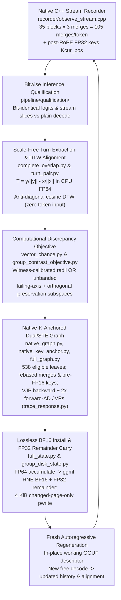

# `signal-trace` Systems & Numerical Architecture

`signal-trace` is the native observation, alignment, and weight-editing engine used to test computational trace repair on **Gemma 4 E2B** (`gguf` BF16/F32). Rather than supervising output tokens or logit cross-entropy, the system records the model's internal residual-stream geometry across all 35 transformer blocks, aligns trajectories purely by how the residual stream turns at every merge, differentiates trajectory discrepancies through a native-anchored PyTorch graph (`records/development/2026-11-12-path-forward/torch_forward.py`, `full_parameters.py`, `full_graph.py` — over the 70 projection matrices in updates `0–317` and all 538 eligible weight tensors from `317` onward), and installs rounded BF16 updates with carried FP32 remainders directly into the native model before regenerating freely.

For executable CLI workflows, see [`TRAINING.md`](TRAINING.md). For research methodology and experimental findings, see [`FINAL-EXPERIMENT.md`](../../FINAL-EXPERIMENT.md) and [`reports/descent-trace-repair/`](../../reports/descent-trace-repair/README.md).

---

## 1. End-to-End System Dataflow

### Stage-by-Stage Numerical Contract

1. **Native Stream Capture (`recorder/observe_stream.cpp`, [`recorder/STREAM-RECORDER.md`](recorder/STREAM-RECORDER.md)):**
   Hooks `llama.cpp` / `ggml` graph execution via scheduler callbacks without per-operation `cudaDeviceSynchronize`. At every generated token and across all 35 Gemma 4 blocks, `observe-stream` writes logical x-fast `float32` tensors (`stream.f32`) and layout/microbatch provenance (`stream.jsonl`) for all **105 residual merges**:
   - Merge $3L$: Attention (`inp_scaled` / `l_out-(L-1)` + `attn_post_norm-L` $\to$ `attn_out-L`)
   - Merge $3L+1$: Feed-forward (`attn_out-L` + `ffn_post_norm-L` $\to$ `pe_in-L`)
   - Merge $3L+2$: Per-layer token/model embedding (`pe_in-L` + `per_layer_embd_out-L` $\to$ `pe_out-L`, scaled by `layer_output_scale` into `l_out-L`)
   In `projection` scope, it additionally records `Kcur_pos-L` (post-RoPE `FP32` keys across all 15 KV-producing layers $0 \dots 14$; layers $15 \dots 34$ reuse KV caches from layers 13/14), `Qcur_pos-L`, `Vcur_normed-L`, and pre-projection norms.

2. **Bitwise Inference Qualification (`pipeline/qualification/qualify_stream.py`, `qualify.py`):**
   Every recorder mode (`residual`, `projection`, `stop_after_last_label`, and `observe-stream-late`) is qualified on the target GPU (`GGML_CUDA_DISABLE_FUSION=1`) against uninstrumented decoding and full `signal_trace.hpp` preimage capture—verifying identical `logits_sha256` at every step and bit-identical float32 outputs across all 55,081 residual and 100,796 projection tensors.

3. **Token-Free Turn Representation & Monotone Alignment (`pipeline/overlap/complete_overlap.py`, `pipeline/weight_edit/turn_pair.py`):**
   For incoming residual $x_{t,m} \in \mathbb{R}^d$ and merged residual $y_{t,m} \in \mathbb{R}^d$, the **computational turn** is computed in canonical CPU `float64`:
   $$T_{t,m} = \frac{y_{t,m}}{\|y_{t,m}\|_2} - \frac{x_{t,m}}{\|x_{t,m}\|_2}$$
   Two trajectories are aligned by flattening each step's 105 turns into a unit vector $\hat{u}_t \in \mathbb{R}^{105 d}$ and solving exact global dynamic time warping (`distance_path` in `complete_overlap.py`) over cosine distance $1 - \langle \hat{u}_i, \hat{v}_j \rangle$ via vectorized anti-diagonal `float64` dynamic programming with deterministic tie-breaking (`diagonal` $\succ$ `vertical` $\succ$ `horizontal`). Token IDs, lexical positions, and output text never enter alignment or loss.

4. **Calibrated Single-Reference & Unbanded Group-Contrast Objectives (`vector_chance.py`, `group_contrast_objective.py`):**
   - **Witness-calibrated vector ball (`vector_chance.Reference`):** Each reference cell $(i, m)$ carries witness-calibrated variance $c_{i,m} \ge 0$, tolerance radius $R_{i,m} = \sqrt{2 c_{i,m}}$, and multiplicity-adjusted mass $w_i = (N_{\text{ref}} \cdot 105 \cdot \text{mult}(i))^{-1}$. Deviations $\Delta = T^{\text{cur}}_j - T^{\text{ref}}_i$ inside $R_{i,m}$ contribute zero residual; deviations outside shrink radially by $1 - R_{i,m}/\|\Delta\|_2$ (with exact identity when $c_{i,m} = 0$).
   - **Signed & affine group contrast (`group_contrast_objective.Objective`):** Partitions cohort operations into `failing` (unbanded signed projection $\langle T, a \rangle - \tau$ along unit repair axes) and `preservation` (displacement $T - \mu$ projected orthogonal to orthonormal nuisance bases $I - V V^\top$ of valid solutions), supporting both fixed baseline support and `live_donor_support`.

5. **Anchored Autograd VJP & Dual-JVP Step Sizing (`native_graph.py`, `native_key_anchor.py`, `full_graph.py`, `trace_response.py`):**
   - **Parameter inventory (`full_parameters.py`):** Classifies all 601 physical GGUF tensors in Gemma 4 E2B and exposes the **538 eligible parameters** (excluding `rope_freqs.weight`, post-last-merge `output_norm.weight` and `blk.34.layer_output_scale.weight`, and unused stored `attn_k`/`attn_v`/`attn_k_norm` on KV-sharing layers $15 \dots 34$; deduplicating tied `output.weight` with `token_embd.weight`; representing embedding tables by compact active-plus-retained row slices).
   - **Reverse-mode VJP (`full_graph._derivative`):** Computes the negative gradient $S = -\nabla_\theta L$ across all 538 leaves using non-reentrant layer activation checkpointing, preserving an explicit distinction between disconnected (`None`) leaves and connected numerical zeros.
   - **Forward-AD step sizing (`trace_response.measure`):** Evaluates $q = J_\theta(r) S$ in a single forward pass via `torch.autograd.forward_ad` dual numbers (no materialized Jacobian or Hessian), computing the exact Gauss–Newton directional minimizer $\alpha^* = -\langle r, q \rangle / \|q\|_2^2$ and scaling by $\eta$. A **second JVP** evaluates the exact realized BF16 displacement $\Delta\theta_{\text{BF16}}$ at unit step length before installation.

6. **Lossless BF16 Installation & FP32 Remainder Carry (`full_state.py`):**
   `accumulate` forms $\text{wanted}_{64} = \text{base}_{64} + \text{remainder}_{32} + (\eta \alpha^*) S_{64}$, casts to `wanted32`, encodes `ggml`-exact round-to-nearest-even (RNE) BF16 bytes (`_bf16_bytes`), and retains the sub-ULP remainder $e' = \text{wanted32} - \text{decode}(\text{raw}_{\text{BF16}})$ in `FP32`. Transactions execute `preview` $\to$ `begin` $\to$ `install` $\to$ `finish` with chunk SHA-256 verification, atomic crash journaling (`working.json`), and fresh autoregressive regeneration on the updated GGUF descriptor.

---

## 2. Why Custom Systems Engineering Was Necessary

Off-the-shelf HuggingFace/PyTorch training loops cannot execute trace-derived repair against a quantized/BF16 C++ inference engine. Three empirical failure modes drove the systems design:

### 2.1 Prefill vs. Decode Kernel Divergence in `ggml` / CUDA
In `llama.cpp`, multi-token prompt prefill dispatches batched GEMM kernels (`MMQ` / cuBLAS), whereas single-token autoregressive generation dispatches matrix-vector kernels (`MMVQ` / warp reductions) with different floating-point reduction trees. In addition, Gemma 4's shared per-layer input projection (`per_layer_model_proj.weight`) executes on `ggml-cpu` over explicit microbatch groups (`inp_scaled`). Feeding a complete response as a single teacher-forced batch in PyTorch produces states and close-margin argmax decisions that diverge from free token-by-token generation.
- **Solution:** `observe-stream` records exact `(call, microbatch, positions)` boundaries per operator; `full_parameters._CpuSharedProduct` and `native_key_anchor.load_native_keys` replay those exact call groups; and every update closes the loop with a **fresh free token-by-token native decode** rather than teacher-forced replay.

### 2.2 Differentiating Across Native BF16 Operands and FP16 KV-Cache Boundaries
A naive `float32` PyTorch re-implementation recomputes keys, values, and shared projections in IEEE binary32 from layer 0 onward. Over 35 blocks, small quantization differences at the `FP16` KV cache and `BF16` CPU projections compound across attention heads—empirically **reversing the sign of local JVP forecasts** on downstream layers (`records/development/2026-11-18-installed-native-key-anchor/README.md`). Simultaneously, small gradient steps rounded directly to `BF16` ($2^{-7}$ mantissa) vanish into rounding deadzones.
- **Solution:**
  1. **Native pre-cache key anchoring (`native_key_anchor.AnchoredKeys`):** Captures native post-RoPE `FP32` keys (`Kcur_pos-L`) at all 15 producer layers and rebases the differentiable graph as $K_L(\theta) = K_L^{\text{native}} + (K_L^{\text{adapter}}(\theta) - K_L^{\text{adapter}}(\theta_0))$ *immediately prior* to the native `FP16` cache cast. This restored exact primal cache values while keeping key derivatives live, correcting forecast signs and reducing finite-step forecast error by **90.66%**.
  2. **GGML-exact STE (`full_parameters._CpuSharedProduct`):** Forward passes round operands with `ggml`'s exact bitwise RNE formula (`(bits + 0x7fff + ((bits >> 16) & 1)) & 0xffff0000`), while custom `backward` and `jvp` rules propagate `FP32` tangents at the exact rounded point.
  3. **FP32 remainder carry + post-rounding JVP (`full_state.FullState`):** Sub-ULP residuals carry forward in `FP32` across steps, and a second forward-AD JVP verifies the actual discrete `BF16` step before bytes touch the model file.

### 2.3 Bounded-Memory Streaming Over 538 Tensors on 16 GB GPUs
Promoting 538 dense weight tensors to `FP32` requires **7.51 GB** (**15.02 GB** with one gradient direction), plus **~790 MB per trajectory** for 105-merge native anchors—exceeding a 16 GB GPU and causing severe OS page-cache refault storms during multi-member group training if flushed naively to disk (an early `fadvise`-drop prototype generated 2.4 TB of disk reads in 4.5 hours).
- **Solution:**
  - **Per-operator CPU-to-GPU staging & streaming VJP sink (`full_parameters._DeviceWeights`, `full_graph._delivery`):** Leaves reside on host memory; each operator transfers only its active block's operands (~280 MB max) under layer checkpointing, and `register_post_accumulate_grad_hook` folds and frees each leaf's gradient immediately during `backward`.
  - **Cooperative `mmap` page-cache stores (`host_pages.Store`, `group_disk_state.Working`):** Dense `leaves` and `remainders` are backed by `posix_fallocate` files using `madvise(MADV_DONTNEED)` on release so only one active tensor occupies process RSS while clean/dirty pages remain in Linux page cache without forced writeback until phase-end `fdatasync` + `malloc_trim(0)`. Native trace merges stream lazily on demand (`group_disk_state.Stream`, `turn_pair.Turns`).
  - **Changed-page-only GGUF writes (`full_state._write_changed`):** Because a typical step alters ~22,000 of 1.9 billion BF16 weights, `_write_changed` diffs previewed chunks against prior bytes and calls `os.pwrite` exclusively on modified 4 KiB OS pages instead of rewriting a multi-gigabyte GGUF per update.

---

## 3. Complete Module Map: Active Core vs. Preserved Historical Solvers

> **Why historical modules are preserved byte-for-byte:** Every executed experiment under `studies/04-round-2-overlap/runs/` and `records/development/` records a `declaration.json` containing the exact `sha256` digest of every Python file in its `implementation` closure (enforced at launch by `final_experiment.sources()` and `run_declaration.check_native_run()`). Retired Round-2 solvers are retained untouched so historical declarations, provenance chains, and paper artifacts remain cryptographically verifiable.

### 3.1 Top-Level Subpackages (`pipeline/`)

| Subpackage | Status | Responsibility |
| --- | --- | --- |
| `pipeline/paths.py` | **Active Core** | Single source of truth for repository, study, and run directory resolution. |
| `pipeline/native_records/` | **Active Core** | Readers for `stream.f32`/`stream.jsonl` captures, native excerpts, operation schemas, and `run_declaration.py` pre-run verification. |
| `pipeline/qualification/` | **Active Core** | Bitwise equivalence verification (`qualify_stream.py`, `qualify.py`, `audit_saved_capture.py`) proving recorder modes match plain `llama.cpp` inference. |
| `pipeline/overlap/` | **Active Core** | Token-free anti-diagonal cosine DTW (`complete_overlap.py`), witness dispersion/envelope statistics, leave-one-out cross-validation, and diagnostic figures. |
| `pipeline/weight_edit/` | **Mixed (See §3.2)** | Active full-graph native learners alongside preserved Round-2 matrix/path solvers. |
| `pipeline/observability/` | **Active Core** | Zero-network local JSONL span/metric emitter (`recorder.py`, `instrumentation.py`) consumed out-of-process by MLflow exporter (`tools/box-image/TRACING.md`). |
| `pipeline/research_guard/` | **Active Core** | Method drift verifier (`verify_round2.py`), R2 archive contracts, and loss accounting (see §4). |
| `pipeline/acquisition/` | **Active / Historical** | Native recorder invocation (`recorder_identity.py`, `export_stream_traces.py`, `late_start.py`) plus Round-1/early-Round-2 cohort preparation (`*_a_*`). |
| `pipeline/decisions/` | **Active Provenance** | Cohort population assignment rules (`population.py`). |
| `pipeline/correspondence/` | **Historical (Round 1)** | Passage and KV-cache correspondence helpers from Round-1 single-pair studies. |
| `pipeline/observation/` | **Historical (Round 1)** | Observational progression and attention/weight transport inspections (`*_a_*`, no weight edits). |
| `pipeline/evaluation/` | **Retired Stub** | Legacy package marker; token/text answer-grading scripts were removed so text never enters training loops. |
| `pipeline/maintenance/` | **Utility** | Repository layout validation (`research_layout.py`, `regroup_repository.py`). |

### 3.2 Inside `pipeline/weight_edit/`: Active Core vs. Preserved Historical Solvers

| Category | Modules | Role |
| --- | --- | --- |
| **Public Experiment Entrypoints (Active)** | `final_experiment.py`, `native_key_experiment.py`, `group_contrast_experiment.py` | Prospective `prepare` / `check` / `run` CLIs for one-pair installed-weight training, native-key-anchored forecasting, and multi-member signed/affine group contrast training. |
| **Differentiable Graph & Step Sizing (Active)** | `full_parameters.py`, `native_graph.py`, `native_key_anchor.py`, `native_key_driver.py`, `native_key_finite.py`, `full_graph.py`, `trace_response.py`, `model_trace_response.py` | 538-tensor parameter inventory, CPU-staged BF16 STE shared projections, native-rebased residual & pre-FP16 key graphs, streaming VJP hooks, and dual-number forward-AD JVP step sizing. |
| **Native State, Paging & Checkpoints (Active)** | `full_state.py`, `host_pages.py`, `group_disk_state.py`, `working_identity.py`, `working_model.py`, `loop_archive.py`, `retired_admission.py` | FP64 accumulation, ggml-exact BF16 RNE encoding, FP32 remainder carry, 4 KiB changed-page `pwrite`, `MADV_DONTNEED` file-backed paging, atomic checkpoints, and guarded R2 trace release. |
| **Turn Objectives, Diagnostics & Stopping (Active)** | `turn_pair.py`, `vector_chance.py`, `reference_rule.py`, `full_loss_maps.py`, `common_prefix_objective.py`, `common_prefix_driver.py`, `group_contrast_objective.py`, `group_contrast_driver.py`, `group_development_origin.py`, `joint_stock_lineage.py`, `validation_stopping.py`, `validation_driver.py`, `trace_stopping.py`, `trace_diagnostic.py`, `paired_turn_signal.py`, `prefix_turn_signal.py` | Canonical FP64 turn extraction, witness-calibrated ball loss, common-prefix directional objective, signed/affine cohort contrast, whole-trace development stopping rules, and non-interfering pre-decision JVP diagnostics. |
| **Preserved Path-Ordered & Linear Matrix Solvers (Historical)** | `a2.py`, `a2_pattern.py`, `ladder.py`, `separable.py`, `mixture.py`, `fused.py`, `correction.py`, `tube.py`, `field.py`, `gap_late.py`, `gap_requests.py`, `gap_rows.py`, `gap_run.py`, `gap_sets.py`, `gap_state.py`, `gap_sweep.py`, `gap_targets.py`, `convex_certificate.py`, `feasible_request.py` | Earlier Round-2 layer-by-layer SVD/ridge least-squares solvers (`ladder`, `tube`, `correction`) and whole-gap sweeps (`field`, `gap_*`). Retained untouched for historical `declaration.json` hash verification. |
| **Preserved Iterative Prototypes (Historical)** | `local_affine.py`, `model_local_affine.py`, `joint_inverse.py`, `joint_inverse_device.py`, `joint_functional_step.py`, `functional_*.py`, `vector_loop.py`, `vector_device_loop.py`, `vector_gradient_loop.py`, `vector_working_loop.py`, `vector_continuation.py`, `vector_recovery.py`, `trace_gradient.py`, `bf16_direction.py`, `turn_correction.py`, `turn_reference*.py`, `turn_support*.py`, `agreement_*.py`, `context_*.py`, `whole_context_*.py`, `whole_field_phase.py`, `success_set*.py`, `operand_phase*.py`, `pair_loop.py`, `pair_evaluation.py` | Intermediate iterative CG/JVP inverse prototypes, 70-projection subsets, and precursor localization studies leading up to the 538-parameter `final_experiment` architecture. |

---

## 4. Scientific Guardrails (`pipeline/research_guard/`)

Every commit (`.git/hooks/pre-commit` / `tools/git-hooks/pre-commit`) and every native training invocation (`run_declaration.check_native_run`) executes automated invariants to prevent silent methodological drift, uncalibrated hyperparameters, or test-set leakage:

- **`verify_round2.py` & `forbidden_bytes.py`:**
  Validates all 220+ run directories under `studies/04-round-2-overlap/runs/` against `studies/04-round-2-overlap/round-2-method.json`:
  1. *Prospective reasoning:* Every `declaration.json` must record `why_this_direction`, `repeating_pattern_check`, `hypothesis`, and `prediction` prior to execution.
  2. *Zero magic numbers:* Every entry in `parameters` must be a structured record citing `measured_from` (an existing repository path), `derivation`, and `scales_with`. Bare numeric literals fail verification.
  3. *Input & output containment:* Declared inputs must resolve inside read-only original-model data, the SHA-256-pinned base GGUF, or valid Round-2 runs; outputs must stay strictly inside the run's own directory; every run must be registered in `ROUND-2.md`.
  4. *Deleted-work quarantine:* `forbidden_bytes.py` performs fast byte-table scans across `pipeline/` and `runs/` to block accidental re-import of retracted first-attempt constructions.

- **`input_archives.py` (`declared-input-archive/2`):**
  Governs bulk trace offloading to Cloudflare R2 (`studies/04-round-2-overlap/input-archives/`). Requires exact per-file `(bytes, sha256)` inventories, full remote readback receipts (`remote_bytes_verified`), and `O_NOFOLLOW` local restore receipts (`.restored/`) matching `(dev, ino, bytes, mtime_ns, ctime_ns)` before any native run may consume an archived input. Strictly blocks (`excluded.json`) any path or pooled membership touching sealed (`reserved-40b`) or held-out (`no_fit_answers`) evaluations.

- **`storage_archives.py` (`declared-input-archive/3`):**
  Extends the archive contract to two non-fitting artifact classes while preserving strict separation of concerns:
  1. *Model weight archives (`artifact: "model"`, `storage_role: "declared-input"`):* Binds edited GGUF files to cryptographic provenance (`produced_by`, `written`, and `original.sha256`) without inventing answer-row memberships.
  2. *Storage-only backups (`artifact: "answer-rows"`, `storage_role: "storage-only"`):* Permits off-disk disaster-recovery copies of named historical unsealed cohorts while stamping an explicit `NO_GRANT` eligibility string refusing fit, calibration, selection, or evaluation admission.

- **`recorded_losses.py` (`recorded-losses/1`):**
  Cryptographically bounds the exact list of 63 untracked intermediate files lost during a November 19 storage incident. A missing path is excused *exclusively* when verifying the exact historical `declaration.json` or archive JSON digest recorded in `recorded_losses`; if a listed file is recovered on disk, verification fails until the loss entry is removed; and `named_in` / `touching` unconditionally refuse to launch any native run whose inputs, targets, or referenced run directories intersect a lost path.
