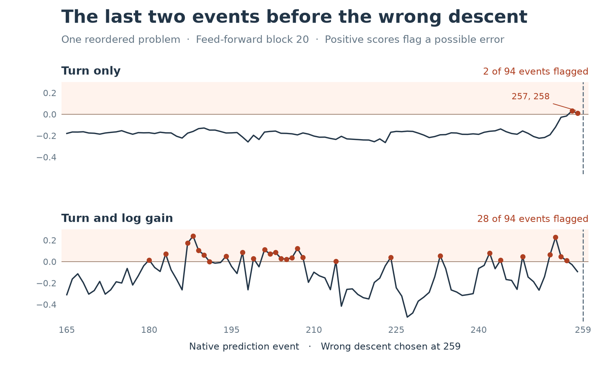

# Where the descent signal appears

November 18, 2026. On the previously missed reordered problem, the model chose the wrong descent operation at native event 259. We scored the feed-forward output of block 20 at every captured event leading up to that choice. Across 94 events, the original turn vector was on the wrong side of the correct-to-wrong group midpoint at just two, **257 and 258**. Adding the historical log-gain coordinate flagged 28 events and put both 257 and 258 on the correct side. The weights and the response were identical in both readings. [Event-by-event scores and capture identities](../studies/04-round-2-overlap/runs/descent-log-gain-and-repair-controls/result.json)

## What changed in the comparison

The turn at a merge is the difference between the outgoing and incoming unit vectors. The second reading appended the log ratio of outgoing to incoming residual norms, multiplied by the square root of the historical size-to-direction weight. For each reading, the score is the signed projection relative to the midpoint between the mean correct and wrong turns in that feature space. The underlying block, donor exclusion and midpoint rule stayed fixed. The earlier learner used a different direction and allowance, and its full-response correspondence paired the reference site with event 296 of the reordered response. The subtraction had already happened 37 events earlier. We used the known sign to *evaluate* the timing of the scan. Each event's score only uses its own computation and the donor summaries. The block and the case had both been examined in previous work. [Comparison declaration](../studies/04-round-2-overlap/runs/descent-log-gain-and-repair-controls/declaration.json) · [Earlier allowance and correspondence](../records/retrospectives/2026-11-17-natural-descent-decisions/README.md)

The same comparisons on 28 original responses used 15 energy configurations of one template. For each response, all donors with the same energy configuration were excluded. These counts refer to the descent operation at the previously selected site. They supply no labels for every other computation in the response.

| Score at the registered site | Wrong descents flagged, of 13 | Correct descents flagged, of 15 |
| --- | ---: | ---: |
| Correct-to-wrong midpoint, turn | 13 | 4 |
| Correct-to-wrong midpoint, turn and log gain | 13 | 6 |
| Distance to nearest correct example, turn | 0 | 1 |
| Distance to nearest correct example, turn and log gain | 2 | 1 |

On the reordered problem, nearest-correct distance flagged all 94 preceding events under both readings. That rule gives no temporal specificity on this case. The turn-only midpoint margins at 257 and 258 were +0.0319 and +0.0093. The exact two-event timing warrants investigation, while the four false alarms on valid descents give us concrete cases any training rule must address. In the original fitted-pair figure the largest joint discrepancy occurred at aligned pair 270, long after the annotated sign at pair 143. [Development results](../studies/04-round-2-overlap/runs/descent-log-gain-and-repair-controls/result.json) · [Paired figure and underlying measurements](../studies/04-round-2-overlap/runs/one-pair-landscape-and-traces/result.json)

### Does the same timing identify the errors in the other 28?

After seeing the two positive events, we specified a follow-up and scored every available pre-choice turn in all 28 original responses. At the two events immediately preceding each response's *actual* first descent operator, **13/13 wrong and 5/15 correct** were positive at both events. An earlier event was also flagged in every wrong response and in seven correct ones. None of the 28 had exactly the two alarms seen on the reordered problem. The five correct alarms here and the four above use different locations. One comparison uses the locally annotated arithmetic decision and the other uses the paired reference location. The extra timing evidence supports a recurring component near the operation, while ruling out “exactly two alarms” as a general account of these recorded failures. The response's first operator was used to evaluate timing after the scores were computed from its turns. [Follow-up specification](../studies/04-round-2-overlap/runs/descent-log-gain-and-repair-controls/timing-comparison.json) · [All 28 event lists](../studies/04-round-2-overlap/runs/descent-log-gain-and-repair-controls/timing-results.json)

## What the two successful weight changes tell us

Starting from the same failing 11 J model, transplanting just the later attention-output weights and transplanting just the later feed-forward down weights each restored the correct 91 J on the fitted problem. We compared the *change in computation* under each substitution, always subtracting the same early model. Across all 105 merges and the 73 prediction events with identical consumed histories, the two turn changes had cosine 0.736. At the later block-20 site the cosine was 0.9991. The log gains there were 0.45234 in the early model, 0.41051 after the attention substitution and 0.41063 after the feed-forward substitution. The turn-only midpoint score also switched sides in both repaired models. By that site the early and repaired generations had already taken different paths. The comparison identifies a feature of reaching the repaired computation on this prompt. It leaves open where the repair arose, and how much of the early agreement is ordinary response to the shared baseline. [Weight substitutions and signed arithmetic](../records/development/2026-11-17-descent-sign-swap/README.md) · [Shared-input and later contrasts](../studies/04-round-2-overlap/runs/descent-log-gain-and-repair-controls/result.json)

## Implication for the next overlap

The five correct descents with the same early warning suggest a different use for the score. It could locate one way of approaching the descent operation in responses of different lengths. An operation locator can be valuable even when both outcomes pass through it. Use it to propose a region, compare incoming and outgoing transformations in the surrounding blocks on those five valid and thirteen failing routes, and look for the part that changes under successful weight repair. Flags at unrelated stages and valid routes that never raise a flag measure the limits of this candidate locator. Turn and gain remain separate observations in that comparison. No duration, threshold or mandatory block follows from one reordered example.

Use the saved successful weight substitutions as an additional reference. Compare the connected changes seen in both repairs with changes between checkpoints that kept the same arithmetic. A candidate region gains support if it tracks a wrong-to-correct reversal, recedes toward valid variation after a repair, and stays quiet on an already-correct route that moves for other reasons. The five correct descents that triggered the pre-choice score are immediate preservation controls. The 387-to-388 fitted reversal and the 175-to-189 arithmetic-preserving transition supply two already captured comparisons. An unused problem is still needed to judge transfer. [Checkpoint arithmetic](training-and-stopping.md) · [Full-path specification](all-layer-conditional-trace.md)

For training, only a region supported by those comparisons supplies a local target. Measure excess along its supported direction relative to the range of correctly performed operations at comparable inputs, compute each event and layer's gradient through the actual trace into the eligible weights, and regenerate the failing prompt after installation. Re-evaluate the local region, the arithmetic and previously correct cases. No training or new generation was performed for this record.
