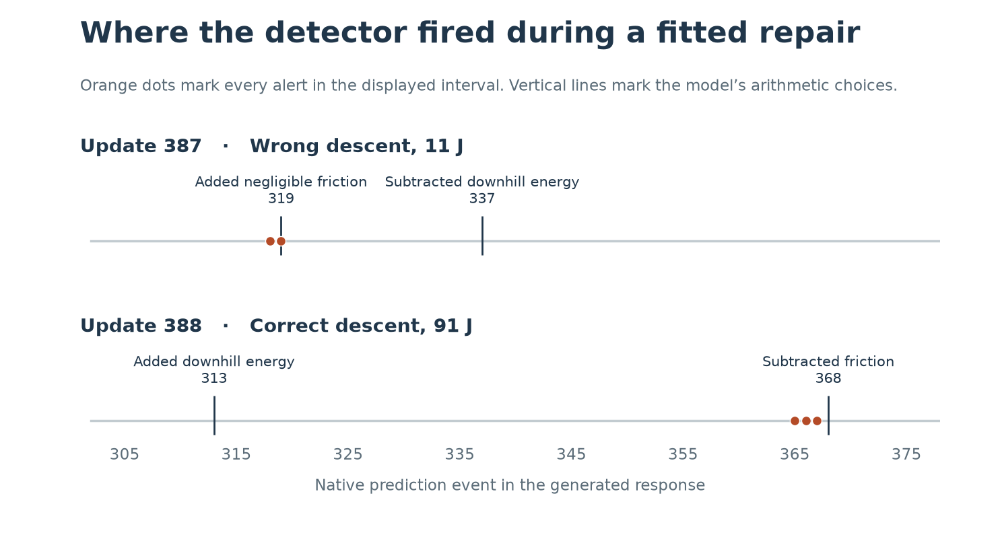

# Distinguishing a wrong descent from a valid route through the same landmark

November 18, 2026. On the 28 original development responses, a computation-only rule flagged all 13 wrong descents and none of the 15 valid descents at the prediction event immediately before the annotated operation. It also flagged the wrong descent on the reordered problem and on two other original responses outside that bank. Running it throughout complete generations exposed a constraint on its use for weight updates. All 15 valid descent responses triggered it elsewhere. On correctly repaired models, one recurring alert immediately preceded the correct subtraction of energy lost to friction. [Registered and first-warning results](../studies/04-round-2-overlap/runs/descent-landmark-route-comparison/result.json) · [Computation-based matching and timing control](../studies/04-round-2-overlap/runs/descent-landmark-route-comparison/registration-results.json) · [Frozen profile comparison](../studies/04-round-2-overlap/runs/descent-landmark-route-comparison/profile-results.json)

## How the comparison works

The earlier block-20 feed-forward turn score highlighted 13 failing and five successful descents. Those 18 responses supply the donor examples for the subsequent comparison. For a query, exclude every donor with the same initial kinetic energy and downhill work. The landmark detector itself uses the former 28-member bank under the same exclusion. At each prediction event, two consecutive positive turn scores propose a comparison. The question and either of its completions can have different lengths. Every query measurement uses only its own current and preceding computation. Arithmetic annotations identify the event for evaluation after measurement.

Start the downstream comparison from the unit direction of the actual outgoing block-20 residual. Within each class of donor find the convex combination of incoming contexts closest to that query context. Carry those coefficients through all 43 remaining residual merges in the same prediction. For merge (j) the evidence for the failing route is the squared distance of the observed turn from the predicted successful turn minus its squared distance from the predicted failing turn. Sum those 43 differences for the signed downstream score. A positive score and an active landmark produce an alert. The archived original block-20 states matched all 14,592 independent generated-row norms exactly. Log-gain contrasts, witness weights and local signed contributions at the evaluated pre-descent event are stored separately. The local comparison describes the observed transitions. It does not isolate a causal matrix or supply an update magnitude. [Declared rules](../studies/04-round-2-overlap/runs/descent-landmark-route-comparison/declaration.json) · [Implementation](../studies/04-round-2-overlap/runs/descent-landmark-route-comparison/measure.py)

## Which events the donors supply matters

Two of the five valid donor traces had registered 32 and 33 events late. These were also the only two valid descents the primary rule misclassified. Taking the very first warning in every donor lost six failing descents. We then fixed a separate follow-up after seeing those results. Within each donor, compare the previous and current block-20 turn at every candidate event with other eligible registered donor pairs. Choose the event that minimizes median distance across energy configurations. The donor search can use its completed recording. The query still gets scored as it unfolds.

| How the donor event was chosen | Wrong descents flagged, of 13 | Valid descents flagged, of 15 | Reordered wrong descent |
| --- | ---: | ---: | --- |
| Earlier whole-response registration | 13 | 2 | Flagged |
| First warning in each donor | 7 | 3 | Missed |
| Similarity of consecutive computational turns across donors | 13 | 0 | Flagged |
| Actual pre-descent event supplied for diagnostic comparison | 13 | 0 | Flagged |

In all 37 original and control comparisons, the third procedure selected exactly the same donor events as supplying the annotations. This amounts to 607 donor assignments with reuse across comparisons. This is retrospective development evidence. The donor set and site had previously been selected with knowledge of the outcomes, and the choice to try this registration followed the discovery of the two late anchors. Holding out an energy configuration during scoring does not undo that history. At the true pre-descent event, the gate and incoming context alone gave the same 28 decisions as the combined rule. The reordered response separates those explanations. The incoming difference was −0.00343 and the downstream difference was +0.07148 at event 258. The single full-response alert preceded the wrong operation at 259. [Follow-up specification](../studies/04-round-2-overlap/runs/descent-landmark-route-comparison/registration-check.json) · [Every donor assignment](../studies/04-round-2-overlap/runs/descent-landmark-route-comparison/registration-results.json)

## What happened under real weight changes

| Fitted capture | Descent | Downstream score just before descent | Landmark active |
| --- | --- | ---: | --- |
| Early swap control | Wrong | +0.00695 | Yes |
| Later attention-output weights alone | Correct | −0.02259 | No |
| Later feed-forward down weights alone | Correct | −0.02228 | No |
| Checkpoint 175 | Correct | −0.02266 | No |
| Checkpoint 189 | Correct | −0.02268 | No |
| Checkpoint 387 | Wrong | +0.02726 | No |
| Checkpoint 388 | Correct | −0.02397 | No |

The signed downstream measurement tracks both the known 387→388 repair and two sufficient weight substitutions. It also stays nearly unchanged across the large overall loss improvement at 175→189, when the descent arithmetic stayed correct. At 387 the incoming-only score would classify the operation as valid. In this response the gate itself missed the error. At 318 and 319 it triggered around the plus that added a term for negligible friction. The actual 40 J descent subtraction was at 337. At 388, 175, 189 and the three successful swap captures the alarms at 365–367 preceded the correct friction subtraction at 368. These six captures share the fitted problem. The earlier alerts at 387 could still matter causally for the later subtraction. Their timing alone cannot establish that. [Checkpoint annotations and verified capture sources](../studies/04-round-2-overlap/runs/descent-landmark-route-comparison/controls/387.json) · [Weight substitution results](../records/development/2026-11-17-descent-sign-swap/README.md)

## Frozen-rule checks outside the 28-response comparison

With the code and rule fixed, both other public original wrong descents were flagged immediately before the operation. They were discovery-10-channel-h1 (event 323) and discovery-17-channel-h1 (313). On the previously observed reference and unfitted development questions, original, 175, 189 and 348 all gave the same qualitative result. The known wrong downhill calculation triggered on the unfitted question at all four checkpoints. The reference's correct downhill calculation stayed clear at all four, but its correct friction subtraction triggered at all four. The repeated checkpoints are observations of the same problems. These are recognition measurements. This study did not edit a model, and none of these comparisons measures cross-domain or cross-model generalization. [Frozen specification](../studies/04-round-2-overlap/runs/descent-landmark-route-comparison/profile-check.json) · [Profile results](../studies/04-round-2-overlap/runs/descent-landmark-route-comparison/profile-results.json)

## Consequence for the learner

A downstream path score can mark the wrong direction when the physical operation is known, including on two routes where the block-20 context alone pointed toward the successful class. A training loop also has to determine which operation the model is executing. Using every alert as a gradient request would target successful energy accounting. Removing the gate would recover the 387 precursor but would also mark five of the ten other valid development descents at their actual pre-choice event.

The next discriminating comparison is within the same response. Trace the computation carrying gravitational work into the energy balance and trace the computation carrying friction loss into that balance. Use naturally varying downhill work and friction loss as separate contrasts to identify which operand the model is acting on. Correct friction subtraction is a positive preservation example. Compare before and after edit on 387 and 388 and retain a fresh problem outside both calibration and selection. The practical success condition is an error signal at the wrong downhill operation that leaves the correct friction operation quiet when the entire generated response is scanned.
