# Figures and recorded screens

## Retained D sampling observations

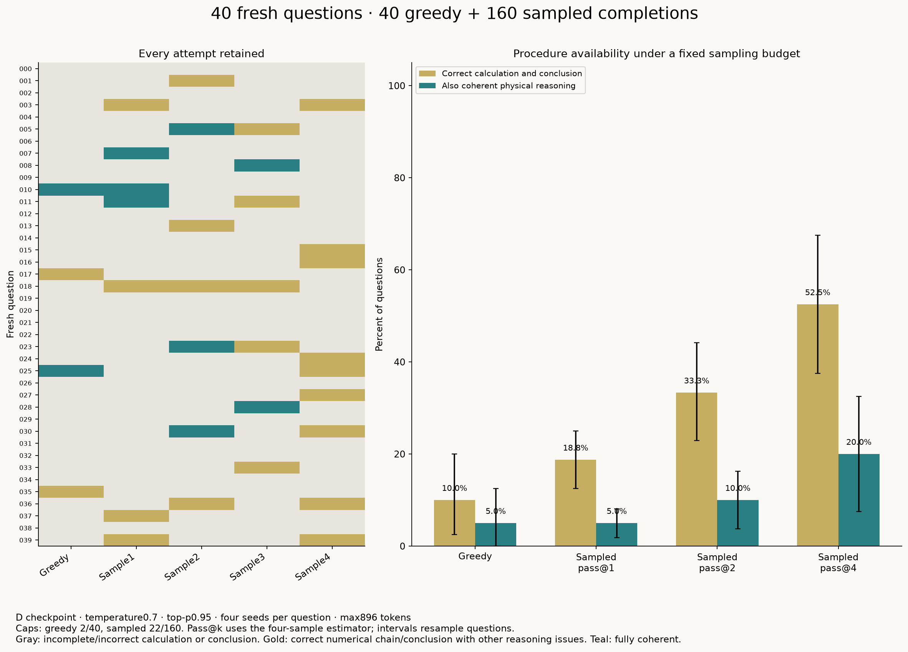

The figure belongs to D: four sampled attempts find a correct numerical solution on 21/40 questions, versus 4/40 greedy. [SVG](exports/physics-multitrace-2026-11-07--fresh.svg) · [report](../../studies/03-round-1-single-pair-edits/multitrace-observations/run/REPORT.md). E's overlap, construction and outcome figures were withdrawn; [removal record](../../journal/2026-11-07-e-withdrawal.md).

## Previous: background sensitivity and candidate D

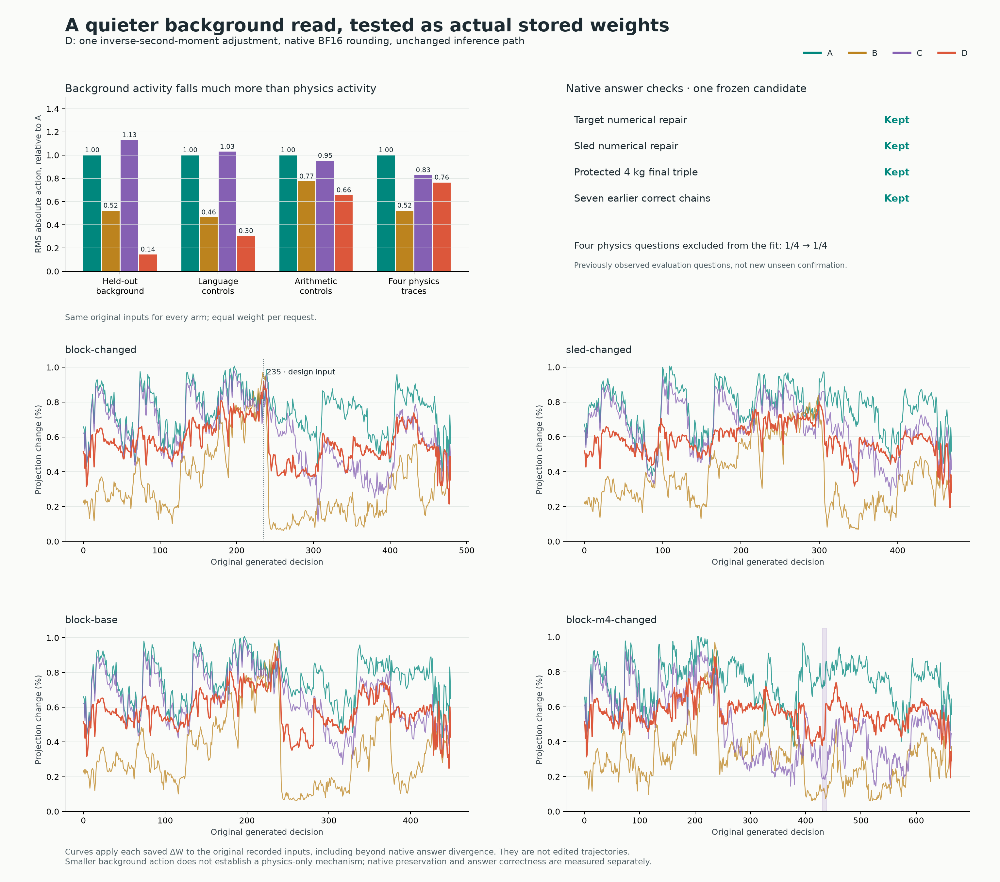

[Report](../../studies/03-round-1-single-pair-edits/D-background-sensitivity/run/REPORT.md) · [publication SVG](exports/physics-background-sensitivity-2026-11-07--candidate-D.svg). D keeps the known repair/preservation outcomes while reducing actual rounded background action. Four held-out-from-fit physics questions still show no gain. Curves apply each actual saved matrix difference to original recorded inputs; they do not depict edited trajectories after divergence.

Companions: [all12 native A/B/C controls](exports/physics-background-sensitivity-2026-11-07--twelve-controls.png), [background mean and held-out traces](exports/physics-background-sensitivity-2026-11-07--background-direction.png), [complete same-input physics curves](exports/physics-background-sensitivity-2026-11-07--same-input-physics.png), and [native controls including D](exports/physics-background-sensitivity-2026-11-07--four-edit-controls.png). Each has a matching SVG export. Their captions distinguish native common-history comparisons from fixed-input calculations.

## Previous: the connected-preservation candidate C

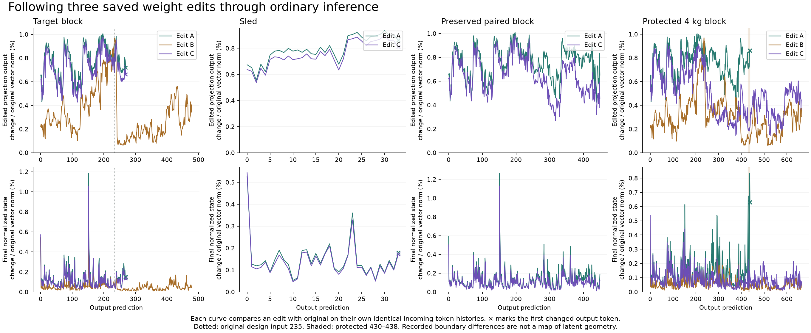

[Publication SVG](exports/physics-connected-edit-2026-11-07--three-edits.svg) · [report](../../studies/03-round-1-single-pair-edits/C-connected-preservation/run/REPORT.md). C preserves the recorded effects associated with both repairs and reduces the effect near the known damaged branch. Each line stops at its own original/edit pair's shared-history limit; an × marks the first different output token. The lines are measured boundary differences, not latent geometry. Behavioral outcomes and fresh-question limitations are in the report.

## Previous: two persistent edits across connected histories

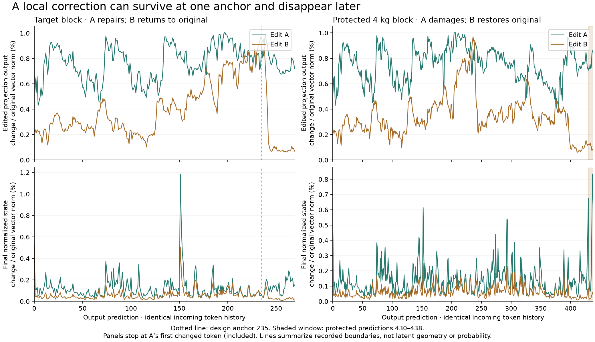

[Publication SVG](exports/physics-edit-footprint-2026-11-07--two-edits.svg) · [interpretation and denominators](../../studies/03-round-1-single-pair-edits/B-selective-footprint/run/REPORT.md) · [interactive four-case A comparison](http://127.0.0.1:4318/?trace=block-changed).

The panels show relative vector change at two recorded boundaries over shared generated histories, through A's first changed token. A and B act similarly at the design anchor but differently later. The lines are not recovered latent geometry or probabilities. The standard plotting script reads the saved trace exports. Finished view captures are in the visual-review folder, including the user's desk viewport, laptop and phone.

## Earlier figures

Seven existing SVG figures are retained in their original study directories and copied byte-for-byte into `exports/` for later writing. The captions below identify what each one is about. None is a new result or a picture of the whole physics capability.

## physics-trace-2026-11-06: counterfactual-default

Pilot: default capture path. Historical recorder limitations are part of this comparison; consult the pilot report before interpreting it.

Original · [Export](exports/physics-trace-2026-11-06--counterfactual-default.svg) · [Study report](../../studies/02-physics-trace-observation/physics-trace-pilot/run/REPORT.md)

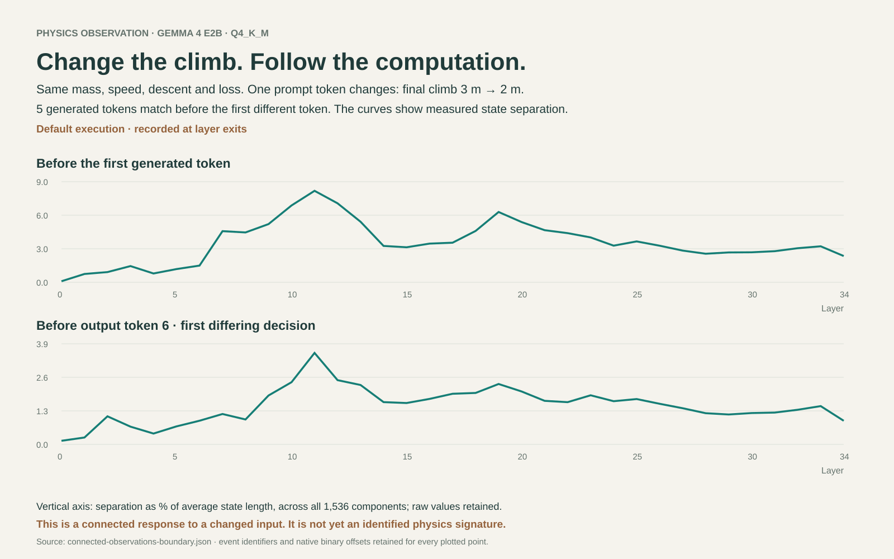

## physics-trace-2026-11-06: counterfactual-unfused

Pilot: unfused recorded counterpart. Keep this alongside the default-path figure, not as an interchangeable measurement.

[Original](../../studies/02-physics-trace-observation/physics-trace-pilot/run/counterfactual-unfused.svg) · [Export](exports/physics-trace-2026-11-06--counterfactual-unfused.svg) · [Study report](../../studies/02-physics-trace-observation/physics-trace-pilot/run/REPORT.md)

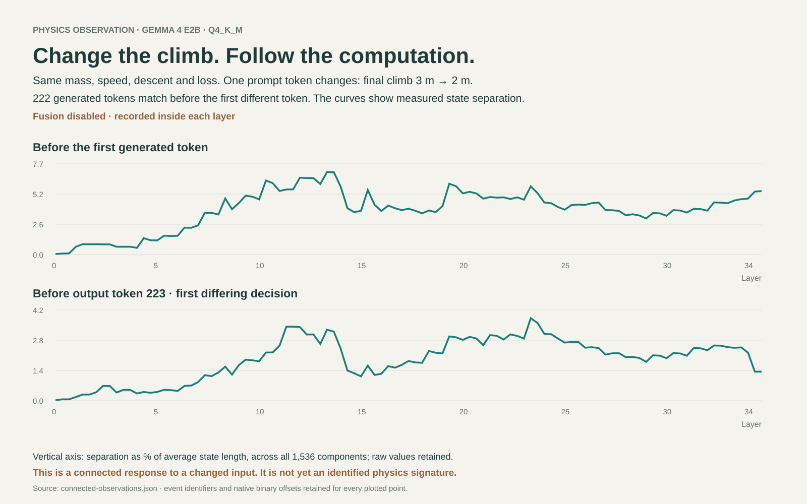

## physics-trace-2026-11-06: local-segment

Pilot: selected connected local segment; not a complete per-weight causal decomposition.

[Original](../../studies/02-physics-trace-observation/physics-trace-pilot/run/local-segment.svg) · [Export](exports/physics-trace-2026-11-06--local-segment.svg) · [Study report](../../studies/02-physics-trace-observation/physics-trace-pilot/run/REPORT.md)

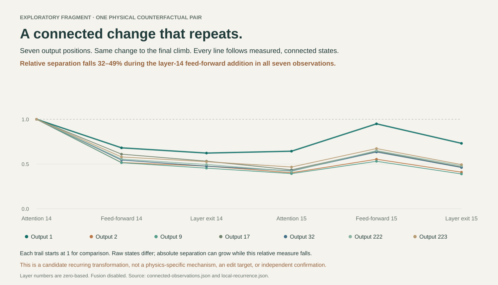

## physics-trace-bf16-2026-11-06: block-calculation-trails

BF16: traces at selected calculation anchors in the block example, before the later persistent weight edit.

[Original](../../studies/02-physics-trace-observation/physics-trace-bf16/run/block-calculation-trails.svg) · [Export](exports/physics-trace-bf16-2026-11-06--block-calculation-trails.svg) · [Study report](../../studies/02-physics-trace-observation/physics-trace-bf16/run/REPORT.md)

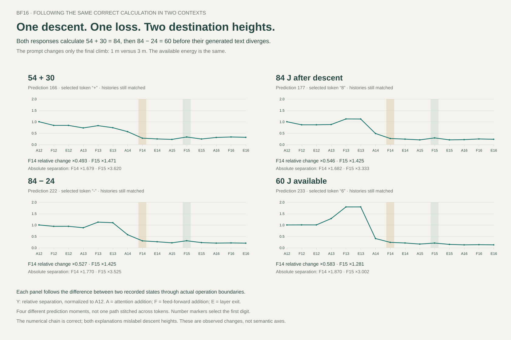

## physics-trace-bf16-2026-11-06: connected-followup

BF16 follow-up: connected transformations using the same question family; retain its own eligibility counts.

Original · [Export](exports/physics-trace-bf16-2026-11-06--connected-followup.svg) · [Study report](../../studies/02-physics-trace-observation/physics-trace-bf16/run/REPORT.md)

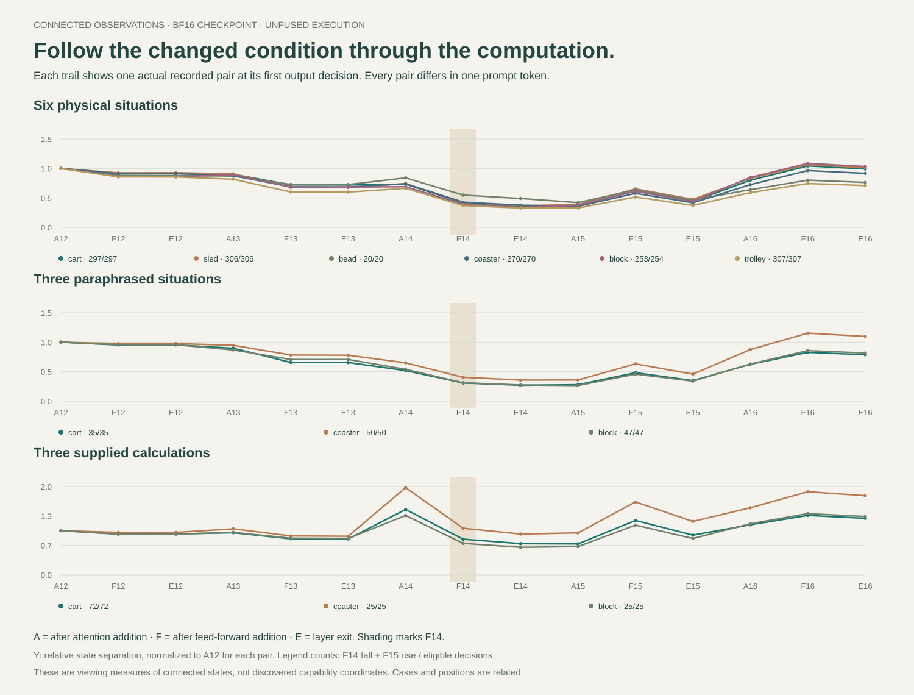

## physics-trace-bf16-2026-11-06: precision-comparison

Q4/BF16 first-decision comparison. This is a different population from the 1,708-decision BF16 recurrence.

[Original](../../studies/02-physics-trace-observation/physics-trace-bf16/run/precision-comparison.svg) · [Export](exports/physics-trace-bf16-2026-11-06--precision-comparison.svg) · [Study report](../../studies/02-physics-trace-observation/physics-trace-bf16/run/REPORT.md)

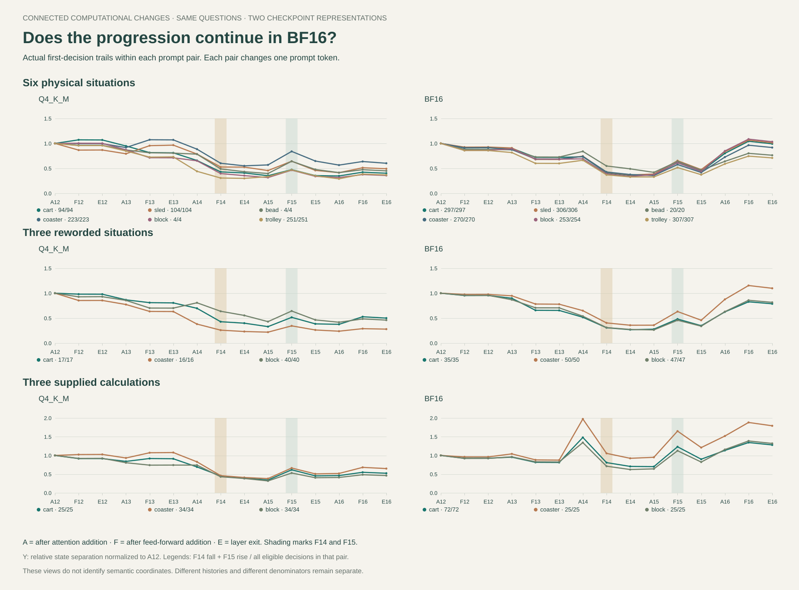

## physics-trace-followup-2026-11-06: connected-followup

Q4 follow-up: connected paired transformations and relative separation across the selected region.

[Original](../../studies/02-physics-trace-observation/physics-trace-followup/run/connected-followup.svg) · [Export](exports/physics-trace-followup-2026-11-06--connected-followup.svg) · [Study report](../../studies/02-physics-trace-observation/physics-trace-followup/run/REPORT.md)

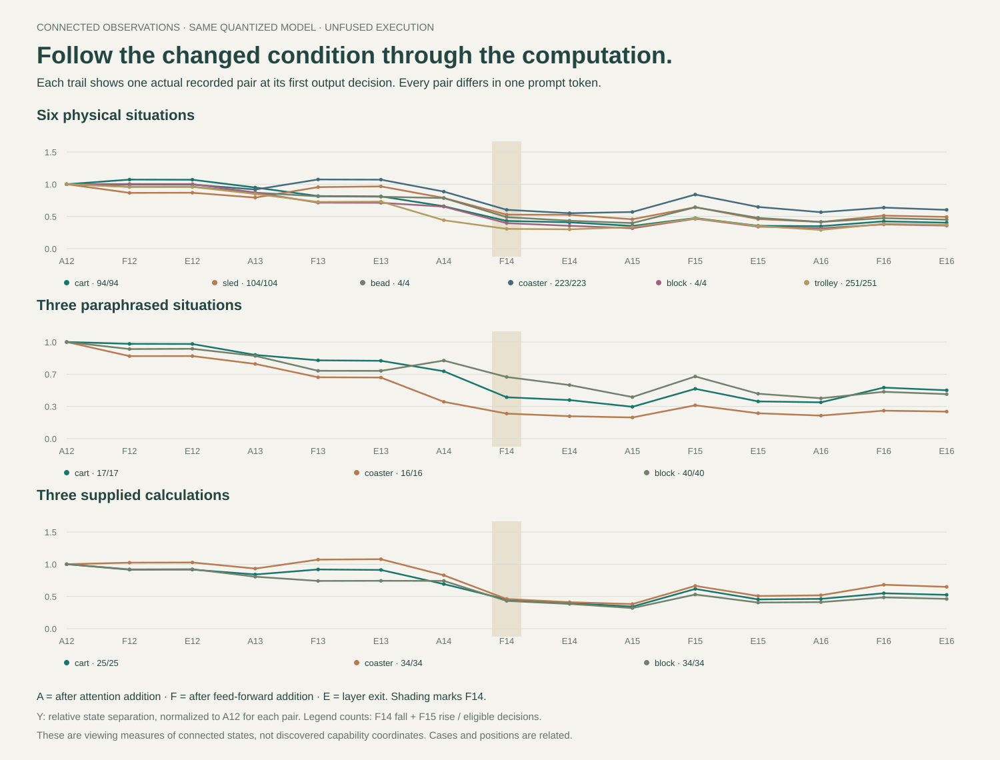

## Decode Machine screens

Retained screens from the 30k observatory work:

- run-view-counters-desktop.png
- run-view-counters-laptop.png
- run-view-counters-phone.png
- run-view-desktop-r2.png
- run-view-desktop-verified.png
- run-view-desktop.png
- run-view-final-desktop.png
- run-view-laptop-r2.png
- run-view-laptop-verified.png
- run-view-phone-r2.png
- run-view-phone-verified.png
