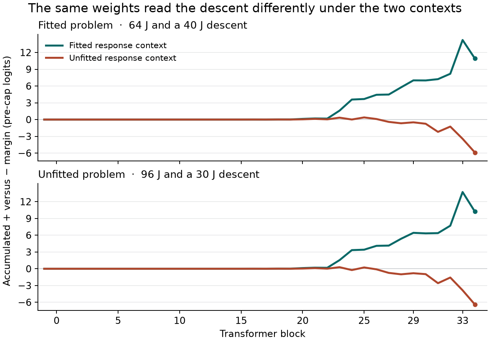

# Why the fitted descent repair did not carry over to discovery-10

The selected original reference, expanded-004-h1, computes the descent correctly. It starts at 16 J of kinetic energy, adds the 40 J released by the drop, and subtracts 12 J for friction. The resulting 44 J exceeds the 20 J needed to climb. It calls the 40 J “Potential Energy gained.” The body loses gravitational potential energy and gains kinetic energy. Both the successful and failing cases use that phrase, so the wording alone cannot explain their different signs. In the original development set, discovery-10-h3 also adds 96 + 30 correctly while discovery-10-h1 subtracts 96 − 30. Only the subsequent climb height changes between those two questions. [Reference and original-development audit](../2026-11-17-descent-reference-adequacy.md)

## The same checkpoint can do the unfitted arithmetic

The two original questions require different numerical calculations. At frozen checkpoint 175, we kept each question and its own numbers and supplied one of the two naturally observed framings up to the instant before the first descent sign. The model freely chose the sign, performed the numerical substitution, applied friction and completed the answer. Both natural controls reproduced the complete vocabulary scores at the first sign and the entire subsequent generated sequence. [Experiment and controls](../../development/2026-11-17-descent-context/README.md)

| Original question | Pre-sign framing | Native score for addition minus subtraction | Free descent calculation | After friction | Required | Verdict |
|---|---|---:|---|---:|---:|---|
| Fitted, discovery-05 | Fitted framing | +6.031 | 64 + 40 = 104 J | 91 J | 20 J | Yes |
| Fitted, discovery-05 | Unfitted framing | −4.558 | 64 − 40 = 24 J | 11 J | 20 J | No |
| Unfitted, discovery-10 | Fitted framing | +6.042 | 96 + 30 = 126 J | 115 J | 30 J | Yes |
| Unfitted, discovery-10 | Unfitted framing | −4.681 | 96 − 30 = 66 J | 55 J | 30 J | Yes |

The framing changed the heading and the name of the unknown quantity. The fitted response called it total energy before the rough section. The unfitted response called it kinetic energy after descent. Within each question, both calculations used the same starting energy, positive descent magnitude and friction. Following the unfitted framing made the fitted case fail. Following the fitted framing made the unfitted case succeed. The identical final verdict on the unfitted case conceals a 60 J error. [Four native readbacks](../../development/2026-11-17-descent-context/native-result.json)

## Changing only the first heading choice

At the heading “State after Descent (”, the fitted model normally begins “before rough section” and the unfitted model normally begins “1 m”. On the fitted question the early transplant control favored the true drop digit “2” over “before” by 0.099 logits. At checkpoint 175, “before” led the digit by 0.313 on the fitted question, while the true digit “1” led “before” by 1.494 on the unfitted question. Those are observed decision margins with each question's own preceding history. Fitted checkpoint scores · [Controlled weight readbacks](../../development/2026-11-17-descent-sign-swap/README.md) · [Unfitted checkpoint and both cases' scores](../../development/2026-11-17-descent-context/heading.md)

We changed only that first heading choice in each otherwise natural history. All 73 vocabulary-score hashes before and at the intervention matched the corresponding natural control. Every subsequent token, including the rest of the heading, the variable definitions and the arithmetic, was generated freely. [Heading intervention and receipts](../../development/2026-11-17-descent-context/heading.md)

Giving the fitted problem its true drop digit “2” induced the incorrect 64 − 40 = 24 J and 11 J available. Giving the unfitted problem “before” produced a different derivation. It correctly computed the signed potential-energy change as −30 J, then wrote kinetic energy as its initial value **plus** that signed change, yielding 96 − 30 = 66 J and 55 J after friction. In this signed convention, kinetic energy increases by the negative of the potential-energy change, so the correct calculation is 96 − (−30) = 126 J. The compact formula matcher did not recognize the new expression. The full native answer retains the complete derivation. Fitted continuation · Unfitted continuation

Thus the heading alone was sufficient to disrupt the fitted answer. Restoring that word alone on the unfitted question left the physical error intact. The measured behavior calls for distinguishing a **positive magnitude of energy released** from a **signed change in potential energy**, then tracking the kinetic-energy change across both representations. The second representation was observed only in this heading intervention. This readback does not establish which further part of the context is sufficient for repair.

## What differed inside the model

At the first freely chosen sign, we projected each of the 105 native residual additions across 35 blocks onto the difference between the output weights for addition and subtraction. Each term uses that execution's final normalization and the actual weight state. The sum, including the input residual, recovers the score difference immediately before the model's nonlinear logit cap. The table above uses the final capped scores. The plot accumulates the pre-cap terms in execution order. Its intermediate points show contributions to the final decision, rather than predictions from truncating the model at each block. Calculation · Native readouts

With the receiving question fixed, the fitted framing increased the pre-cap addition margin by 16.814 logits on the fitted problem and 16.625 on the unfitted problem. The feed-forward addition in zero-based block 33 contributed 8.179 and 8.237 logits of those respective differences, about half in each case. That locates a large part of the observed change in the final readout. Each execution has its own final normalization, and earlier computations supply the inputs to block 33. The plot groups all three contributions per block. An independent read of all 105 terms in all four sign decisions reproduced the terms to within 9 × 10⁻¹⁶ logits. The fitted-case weight transplants also showed that installing either of two later weight families could restore addition. Readout review and provenance · [Transplant and controls](../../development/2026-11-17-descent-sign-swap/README.md)

The readout covers 18 retained native histories at four positions each. Across those 72 observations the largest difference between the additive sum and the reconstructed pre-cap margin was under 0.000004 logits, and individual reconstructed scores differed from available retained native top-eight scores by less than 0.00020 logits. The fitted 348 raw stream was archived and is outside this readout. The independent local-loss audit used its saved correspondence and loss map. Local-loss audit

## What the training loss registered

The computational alignment paired the row that chooses the first sign with exactly the corresponding row of the fixed reference in all eight audited histories. Every one of its 105 local merge distances was inside tolerance, including on the early, still-wrong fitted model and on the unfitted model at 175, 189 and 348. The later numerical repetition of the wrong subtraction produced positive loss at ten merges. At the upstream heading choice, the unfitted model at 175 had a small positive local discrepancy at two merges on an additional alignment pair. The row choosing the name of the quantity had zero local loss. The loss at subsequent positions can still propagate into earlier weights, and the unfitted example supplied no training gradient. Per-position and per-merge evidence

These results identify a dependence on self-generated context in this fitted/unfitted pair. They also explain how a falling computational loss and a correct final verdict could coexist with a wrong intermediate operation. Whether the update learned a repair that works across valid ways of framing the same calculation needs a further free-generation test on unused development data. These experiments measured neither comparative training cost nor RL efficiency.
