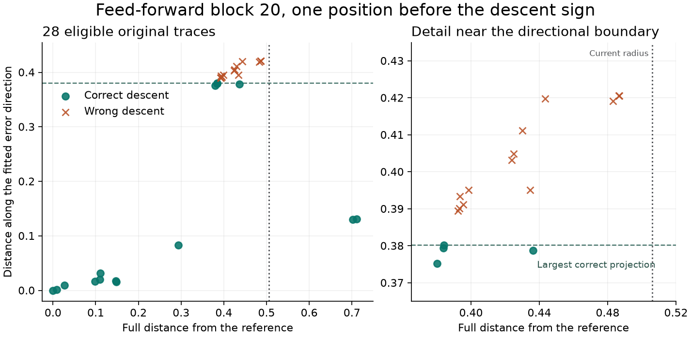

# The descent precursor in free generation

At feed-forward block 20, one position before the symbol combining the descent energies, the current computational turn already contains a recurring directional difference. Taking only the distance from the fixed correct reference loses that distinction. The November 12–13 work had already located a precursor across the preceding positions. The new finding is which part the current one-reference measurement retains, what its tolerance accepts, and how that compares with the internal feed-forward activations. [Historical experiments, source and sensitivity to correct supports](../2026-11-17-pre-sign-localization-history-eli.md)

## How close was the decision?

In the matched native weight-transplant controls on the fitted question, the early and late models freely generated the same first 72 tokens. At “State after Descent (”, the early model scored its true drop digit “2” at 14.519 and “before” at 14.420. With the later feed-forward weights alone, “before” scored 14.434 and “2” scored 14.407. Its margin over the actual runner-up was only 0.00748. By the time it produced the arithmetic operator, addition already led subtraction by 6.039 logits. At frozen checkpoint 175 on the naturally wrong, unfitted question, the true drop digit led “before” by 1.494 and subtraction later led addition by 4.681. These are two decisions in different contexts. A logit margin does not have the units of a trace distance. All native decision scores

Every one of the 30 original development recordings retained both competing scores where it combined the descent energy. Among 15 wrong original subtractions, the lead over addition ranged from 1.099 to 6.855 logits, median 3.887. Among 15 net-correct additions, the lead over subtraction ranged from 2.245 to 12.123, median 5.920. Two correct originals made an earlier incorrect zero-change claim and combined the actual energies later. One wrong original stopped at its token limit after its recorded subtraction. Native scores and arithmetic annotations · [Reference and operation audit](../2026-11-17-descent-reference-adequacy.md)

We found ten original opposite-outcome pairs whose prompts differ only by friction or final climb height. All ten first differed in their generated text before choosing the descent operator. In the original discovery-10 pair the identical generated prefix ended immediately before a section heading. The correct answer preferred “After” to “State” by 0.096 logits, and the wrong answer preferred “State” by 0.056. Those answers then combined identical operands as 96 + 30 and 96 − 30. This identifies a close fork in ordinary generation. The two prompts differed and this comparison does not assign causal force to that word. Pair inventory and exact shared prefixes

## Splitting attention, feed-forward activations and residual changes

The training trace measures the normalized change from incoming to outgoing residual at each of three separate merges in each of 35 blocks. It measures attention and feed-forward contributions at their residual merge, but the individual gate activation, up projection, their product, and the attention routing across earlier positions do not each have a separate loss term. The historical reading also used the change in log residual size and compared an operation to a mixture of correct operations chosen by its incoming computation. The current loss instead uses the single selected reference and a per-merge tolerance on the full vector distance. [Final experiment](../../../FINAL-EXPERIMENT.md) · [Historical source comparison](../2026-11-17-pre-sign-localization-history-eli.md)

To compare those representations on identical examples, we read the 30 original histories at the four positions kept in the old study. We constructed the comparison direction solely from the original wrong fitted member and the original selected correct reference at each site. Eight same-descent pairs were eligible after excluding the construction pair and a pair where the older annotation pointed to the earlier zero-change claim. The eight pairs represent 13 distinct questions. Three pairs use the same quantity-label category and share the same correct member. The saved report includes both raw branch and normalized turn, incoming and outgoing residual, size change, and gate, up, gated product and down projection. The MLP internals are reconstructed in CPU float32. Across the seven previously identified feed-forward blocks, the worst relative difference between our reconstructed post-normalization branch and the archived addition was 0.00000630. Analysis plan · Branch measurements · Activation reconstruction

At feed-forward block 20 one position before the sign, the one-pair directional reading placed the wrong member farther toward the fitted error than the correct member as follows. Each representation uses its own axis derived from the same pair.

| Measured representation | Pairs ordered in the expected direction | Same quantity label | Pairs ordered by full distance |
|---|---:|---:|---:|
| Incoming residual | 5/8 | 0/3 | 5/8 |
| Gate before nonlinearity | 5/8 | 0/3 | 5/8 |
| Up projection | 5/8 | 0/3 | 5/8 |
| Activated gate multiplied by up projection | 8/8 | 3/3 | 5/8 |
| Down projection before normalization | 8/8 | 3/3 | 5/8 |
| Branch added after normalization | 6/8 | 1/3 | 5/8 |
| Normalized input-to-output turn already in the training trace | 8/8 | 3/3 | 5/8 |

The existing turn preserves this difference on these questions. An internal activation is another place it can be measured. The readings are correlated, and the comparison neither identifies a unique origin nor demonstrates an advantage from adding an activation loss. These four diagnostic positions came from the original study's sign-relative annotations. The tolerance measurement below uses the learner's computational correspondence. Every position, group and individual site · Feed-forward channels

## Why a smaller radius cannot solve this case

At fixed reference position 312 and merge 61, the radius is 0.50603. It accepts all 13 wrong traces examined. A correct witness lies 0.71061 from the reference, while the fitted wrong witness lies only 0.39333 away. Since the correct computation is farther away, tightening a single radius to catch the fitted wrong computation inevitably flags that correct witness too. Two correct witnesses were already outside the original radius at this site. [All individual distances and feasible-radius calculation](../2026-11-17-native-tolerance-recurrence/radial-separation.json)

In the direction from the reference turn toward the original fitted error, the largest projection among the aligned correct witnesses was 0.38018. The 13 wrong projections spanned 0.38941 to 0.42060. The early wrong fitted control projected to 0.39114 and its corrected counterpart to 0.02166. The computational analysis examined 945 event/merge cells informed by earlier studies. The site and observed separation are development findings. Their ability to direct a useful weight update must be tested on a separate prompt. [Exact axis and its calibration](../2026-11-17-native-tolerance-recurrence/axis-row312-merge61.json) · [Reserved transfer question](../../development/2026-11-17-isolated-pre-error-update/transfer-selection.md)

## One actual update and an independent transfer question

The directional update did not repair the fitted subtraction or carry that repair to the prospectively reserved public development question. All three directional-arm generations reproduced their complete original token sequences. The ordinary update changed the fitted and reference continuations. The installed directional and ordinary weights differed at **2,056 values across 84 parameter tensors**. The two updates had equal access to all 538 eligible tensors, and each used one fitted question. [Native experiment result](../../../studies/04-round-2-overlap/runs/vector-chance-isolated-pre-error-device-continuation/result.json) · Native installation comparison

| Freely generated case | Correct available / required | Original model | Ordinary one-step update | Directional one-step update |
|---|---|---|---|---|
| Fitted | 91 / 20 J, yes | 11 / 20 J, no | −9 / 20 J, no | 11 / 20 J, no |
| Selected correct | 44 / 20 J, yes | 44 / 20 J, yes | 44 / 20 J, yes, with intermediate errors | 44 / 20 J, yes |
| Reserved transfer | 47 / 60 J, no | 67 / 60 J, yes | 67 / 60 J, yes | 67 / 60 J, yes |

On the fitted case all three subtracted the descent gain and found 24 J. The ordinary update went on to deduct the climb requirement from the 11 J left after friction. On the reference, that update asserted that 16 J equalled 40 J and briefly calculated 60 J for the climb before correcting its final comparison. On the reserved question all three subtracted 20 J from 36 J, deducted 9 J friction, and then incorrectly added the 60 J climb requirement to 7 J. Their 511 generated tokens matched exactly. At the first symbolic operator on that question the scores for subtraction exceeded addition by 10.896, 10.855 and 10.886 logits respectively. [All nine source-bound answers, scores and first changes](updated-answers.json)

Measured on fresh generation with the common original loss, the fitted objective went from 0.000292457 to 0.001622357 with the ordinary update and to 0.000291610 with the directional update. The latter is a reduction of about 0.29%. At the selected site, however, the positive excess increased from 0.013111 to 0.013493 with the directional update. It was 0.015255 after the ordinary update. The original tolerance and global objective remained in force elsewhere; the added term had contributed 0.00000000292346 to the initial fitted objective. Its small share of the loss does not determine the size of its weight gradient. [Native losses and local projections](../../../studies/04-round-2-overlap/runs/vector-chance-isolated-pre-error-device-continuation/result.json)

The reserved question exposed a separate problem in correspondence and in the direction itself. On the unedited model, the reference precursor at row 312 corresponded to current row 296, when the first arithmetic operator had already been chosen at row 259. The preceding row 258 corresponded to reference row 261. The original directional projections were 0.14120 at the paired row and 0.27370 at the row immediately before the actual choice. Across all 93 recorded decode positions before that choice, the largest projection onto the same frozen axis was 0.29950. All were below the 0.38018 boundary. The ordinary and directional updates gave the same correspondence, with maxima 0.29938 and 0.29940. Text located the actual equation only for this retrospective comparison. The weight updates used their original computational alignments. Thus changing sequence alignment alone would not make this fixed signal recognize the held subtraction. [All three comparisons](transfer-correspondence.json) · Native turn extraction

The first treatment worker stopped before making a proposal because it used an index on a different device from its activation. The continuation corrected index placement, verified the backward derivative and forward response on the GPU, retained the original and ordinary controls, and completed just the missing treatment. All three arms used free generation. Continuation review · [Living experiment record](../../../final-experiment/README.md)
