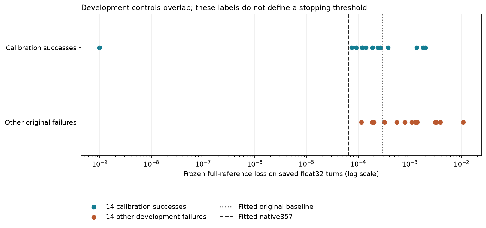

# What can calibrate enough for the one-pair experiment?

Independent saved-record analysis, November 17, 2026; control arithmetic completed20:06 CT. The current-weight snapshot is explicitly bounded at recovery local9 / historical357, measured at19:59:44 CT; later training is outside this report. The desktop root remains the sole controller.

**There is no measured scalar threshold that certifies “enough.”** There is substantial, repeated improvement of the fitted computation, and the fitted loss is below every original failing development control measured here. The development success/failure distributions overlap, their labels do not certify every intermediate computation, and today's edited weights have no corresponding preservation or independent-transfer measurements. These observations calibrate the size and limits of the evidence; they do not invalidate the selected-reference experiment or supply a new stop rule.

## The comparison actually made

The fixed reference is `expanded-004-h1`, with560 original events,105 merges and1,536 coordinates. The loss remains the sum over all computationally matched cells of

`mass × max(||current turn − original turn|| − sqrt(2 × original chance), 0)²`,

where each original event/merge has total mass `1/(560×105)` divided among its matches. Correspondence remains complete cosine DTW over the flattened turn field. No label, text criterion, new tolerance, restricted merge set or altered normalization entered this calculation.

The fourteen nonself positive measurements under the exact canonical instrument already existed in `vector-chance-original/original-coverage.json`. All30 development members also retain complete question and answer turns in the older float32 representation, bound by `success-set-reference-original/turns/turns.json`. I verified all60 array hashes and shapes against that manifest, recomputed correspondence with the existing implementation, and used the existing `vector_chance.outside` function on every cell. Every observed event and every reference event is represented; every control has105 merges and total mass one to floating-point reduction precision. Labels came from the retained original development membership, with no new output judgment.

**The new30-control calculation uses the exact loss formula on saved float32 turns. It is not a bit-exact native float64 remeasurement.** The cohort's native state arrays and fourteen nonselected float64 witness arrays were archived after verified copies; no restoration was performed. All16 available comparisons—fourteen nonself positives, the fitted original wrong member and the selected self-reference—retain identical pair maps. The largest absolute scalar discrepancy from the exact historical score is `5.523454957301333e-13`. The selected self-control reads `3.6524275098193835e-18` instead of mathematical zero. This is an observed representation check, not a formal bound on the other negatives or their unknown exact pair maps.

Strict zero-radius counts are substantially more sensitive: all15 nonself comparisons gain exactly1,365 outside cells, the number of zero-chance cells. For the fitted original, loss changes only `1.6207315437638536e-13`, while outside count changes4,386→5,751. The rounded control counts must not be used as canonical closure measurements, or as evidence for changing tolerance. The actual learner still uses canonical float64 normalization.

## Original control distributions

| Original development population | n | Minimum loss | Median loss | Maximum loss |
| --- | ---: | ---: | ---: | ---: |
| Nonself successes, existing exact canonical measurements |14|9.791098848e-10|0.0002141627766|0.001992035641|
| Same successes, saved float32 reconstruction |14|9.791099721e-10|0.0002141627766|0.001992035641|
| All failures, saved float32 reconstruction |15|0.0001155733366|0.001083492451|0.01073006522|
| Failures other than the fitted member |14|0.0001155733366|0.001170045910|0.01073006522|
| Other failures that ended naturally |13|0.0001155733366|0.001083492451|0.003865962673|

The last row discloses the acquisition difference, without discarding the capped observation from the primary result. `expanded-001-h3` supplied all940 observed events, but its generation ended at the recorded limit. All30 histories were the original model's own recorded choices;29 ended naturally. Complete observed-trace coverage is distinct from a naturally finished response.

Among the14 other failures and14 calibration successes, the failure has higher scalar loss in142/196 comparisons, or72.44898%. These196 comparisons are not independent samples. Ten of the14 other failures fall inside the positive range, and11 of14 positives fall inside the negative range. There is no separating threshold in these observations. The nearest original failure is `expanded-045-h1` at0.0001155733366; the near-reference positive `discovery-01-channel-h1` is9.791098848e-10 under the exact instrument.

“Other than the fitted member” does **not** mean independent validation. All15 successes participated in reference selection, and the14 nonself successes calibrated chance. The other failures are outside today's one-pair gradient, but belong to the previously examined development cohort and earlier research. Leave-one-witness-out chance in the old coverage record uses a different tolerance for each witness and retains original reference-selection exposure; it is not the exact current loss or an untouched validation distribution.

The complete table, all per-merge and per-reference contributions, saved pair maps and summary retain every member. The near-zero positive, capped negative and all overlaps remain included.

## What today's fitted weights demonstrate

| Native observation | Full fresh loss | Events |
| --- | ---: | ---: |
| Original fitted model |0.00029234223350039747|578|
| Full538-parameter phase start317 |0.00006447133821394787|612|
| Recovery348 |0.00006420801373277710|612|
| Best in this finite recovery snapshot355 |0.00006392913419440382|612|
| Excursion356 |0.0007368465433139142|631|
| Latest included357 |0.00006457636634994139|612|

All ten348–357 observations ended naturally, cover the full original reference and105 merges, and retain the identical loss/reference/chance identity. The seven consecutive updates349–355 reduced fresh loss;355 was78.13% below the original and0.841% below317. The next update switched paths and rose sharply;357 returned to the612-event route but remained1.012% above355. This sequence supports learning with recurrent reversals. It does not establish a plateau, a native floor or robust convergence. Nor is a percentage reduction in squared trace loss a percentage of repaired capability.

At357, the fitted scalar is below13/14 calibration successes and all14 other original failures in the reconstructed distribution. That is a useful description of how far this one fitted case has moved relative to the original development cases. It is not evidence that all those successful computations were worse, that the fitted answer is now certified correct, or that the original hypothesis is wrong. Marcos's November17 scope correction expressly preserves the selected-reference first experiment; outcome-successful traces can contain incorrect intermediate computation, and this analysis does not attribute their positive cells.

Aggregate progress also leaves concentrated differences. At357, merge0 contributes40.40% of full loss, and reference events373/374 at that merge contribute31.68%. The maximum local excess is0.941579 in turn-vector units. Zero-radius cells contribute1.069% of357's loss. These maps identify remaining computational discrepancies; they do not establish which residuals prevent repair or what is irreducible. Exact finite-snapshot records and hashes.

## What is missing for preservation and transfer

The inspected current lineage regenerates the single fitted member. It does not report fresh computation for the selected original prompt, other successful development prompts, or independent failing prompts under today's edited weights. The immutable reference is a target, not a measurement that the edited model still produces its successful computation. Therefore current preservation and transfer are **unmeasured**, not zero and not disproved.

The older D1 record reports two retained repairs, preservation of all seven originally correct numerical chains and no gain on four excluded physics questions. The retired larger A2 first pass reports9/31 repairs and6/9 regressions on a separate, subsequently examined comparison set. Those records explain why repair and damage must be measured separately. Their weights, construction, observation rules and datasets differ from today's experiment; their numbers cannot calibrate a current loss threshold. No old output-based judge or preservation term is imported into current training.

The four original documents remain the scientific context: useful partial trace repair does not require an exclusive complete capability signature; local agreement alone does not establish downstream preservation; native rounding and changed histories affect the response; and refreshed trajectories plus later preservation/transfer evidence are necessary for broader claims. Later one-pair and nonzero-loss clarifications govern the present scope. No document supplies a validated numeric endpoint for this frozen loss.

## The defensible meaning of enough

For this first experiment, the defensible report is the reached **fresh full loss, complete maps, and reproducible learning trajectory relative to the fixed original**. Research judgment can end a phase when the actual sequence no longer gives useful improvement, reporting the residual and unresolved cause. Today's finite sequence contains new decreases and repeated excursions; it supplies neither an automatic plateau rule nor grounds to promise that more iterations must help.

For the broader capability claim, the missing calibration is empirical: prospectively freeze one actual reached checkpoint and the measurement protocol, then compare original and edited native computation on preselected development successes and failures. The smallest preservation check is fresh generation of the selected original's own prompt under the edited weights, compared with its fixed original trace; it is useful but still exposed to reference selection. Additional development cases can inform the procedure, while a later untouched evaluation must remain outside training, calibration and checkpoint choice. Repeatedly inspecting a validation set to choose checkpoints consumes its independence.

No new native run is requested or launched here. There is no reason to retune the reference, widen tolerance to admit the controls, demand zero, or choose a favorable historic model from these distributions. The stronger claim remains available to test after an actual freeze, with preservation and transfer recorded regardless of whether their outcomes are favorable.

## Provenance and limits

`PLAN.md` preceded arithmetic; the project verifier passed. Computation was CPU-only, one thread, with the active run's Torch2.15.0/NumPy2.5.5 environment. `measure_saved_controls.py`, `measurement.log`, `controls.json` and `summary.json` retain code, input hashes, runtime versions and numerical qualifications. No GPU, new acquisition, weight update, archival restoration, upload or deletion occurred; active source and declarations were unchanged.

Path discovery encountered member names/counts in the existing mixed `input-overlap/inputs/index.json` inventory. No no-fit trace row or response payload from it entered this analysis; the actual60 turn arrays were checked against the explicit30-member development definition. No sealed directory was opened. Output text was not used to grade or select any result.
