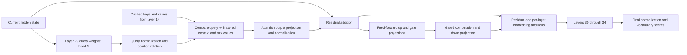

# Propagation of an existing lookup edit — corrected interpretation

November 6, 2026. Offline inspection of existing llama.cpp recordings. No training, new generation, or new weight edit was performed.

**Correction:** this report originally claimed to identify a segment of the capability's path. That interpretation was incorrect and is withdrawn. Marcos means a frozen pattern distributed through portions of the weights' numerical encoding. This analysis followed an existing intervention's effects through the architecture. Those measurements remain observations of perturbation propagation; they do not identify the encoded path, even partially. The distinction is documented in the revised research reference (`~/Documents/dev/projects/qgre/qgre-main/runs/legs/gemma4-e2b/distributed-pathways-reference-2026-11-06/REFERENCE.md`).

## Question

The intended research question was whether observations of a capability could reveal its frozen distributed encoded pattern. The analysis instead answered a narrower question: where do recorded values change after a particular query-weight edit, and how are those differences assembled by later operations? The behavior used was selecting the first or last value for a repeated key.

## What this inspection found

The recordings expose changes in a query, its comparison with earlier cached information, and the propagation of differences through attention, feed-forward operations, residual additions, and later layers. This describes the effects of a perturbation along known computational connections.

The prior experiment changed only layer 29's query head 5. Its saved before/after recordings act as a marker for propagation. Starting from that edit preferentially reveals what the edit disturbs; it does not establish which frozen pattern constituted the original capability.

All layer, head, and channel indices below are zero-based.



The arrows represent architectural connections. They were supplied from the computation graph, not discovered as the encoded pattern behind a capability. Recorded values cover many endpoints; neither the arrows nor those values constitute an identified path in Marcos's sense.

## What is directly supported by the captures

There are 48 paired captures: eight discovery families, two layouts, and three instruction modes. Sixteen are default prompts, sixteen explicitly request the first occurrence, and sixteen explicitly request the last. The capture code records the final token position of each prefill chunk for most intermediate arrays and all positions for the captured keys and values. It disables internal capture during subsequent generated tokens.

For all 48 pairs, the first changed recorded layer output is layer 29. At that layer, the other seven query heads are exactly unchanged in the recorded arrays. The selected query head changes, and the resulting differences appear in the attention output, feed-forward processing, and subsequent layers.

This is an observation of the saved arrays, not a claim about every unrecorded intermediate operation or about the entire generation.

### A concrete before/after example: the repeated key Kiv

The saved prompt contains:

```text
Kiv = blue
Lom = red
Kiv = green
Pex = yellow

What is Kiv's value? Reply with only the value.
```

For this default prompt, the earlier edit changed the ordinary-server answer from `green` to `blue`. The captured run agrees in both conditions.

At layer 29 head 5, diagnostic affinity toward the `blue` value positions rises from 12.72% to 75.00%; affinity toward `green` falls from 74.13% to 11.09%. These affinities are reconstructed from captured queries and keys before cache rounding, not measurements of the attention kernel's exact probabilities.

The changed computation then remains visible in the recorded layer outputs:

| Layer | Change relative to the original layer-output norm |
|---|---:|
| 29 | 14.30% |
| 30 | 13.26% |
| 31 | 12.73% |
| 32 | 12.60% |
| 33 | 11.41% |
| 34 | 4.93% |

The first-token logit margin, `blue` minus `green`, moves from −1.811 to +3.116. A local intervention therefore has an observable route into a changed answer in this example. This does not establish that every recorded difference is necessary for the answer change.

## Where the change is carried and transformed

Gemma's recorded operations allow an additive decomposition at each layer:

`layer output = layer scale × (incoming residual + attention branch + feed-forward branch + per-layer embedding branch)`

For each before/after pair, we projected each branch's change onto that layer's total output change. These signed projections sum to approximately one. They describe how the recorded difference is assembled; they are not independently measured causal responsibility or percentages of the model's knowledge.

Across the sixteen default prompts:

| Layer | Incoming residual | Attention branch | Feed-forward branch | Per-layer embedding branch |
|---|---:|---:|---:|---:|
| 29 | 0.00% | 76.76% | 23.31% | −0.07% |
| 30 | 83.11% | 0.69% | 16.16% | 0.04% |
| 31 | 88.82% | 0.08% | 11.16% | −0.07% |
| 32 | 82.42% | 0.60% | 16.81% | 0.16% |
| 33 | 69.87% | 1.71% | 26.42% | 1.99% |
| 34 | 18.55% | 0.92% | 80.27% | 0.26% |

The same difference is carried forward and transformed. In particular, the final layer's feed-forward branch contributes most of the projection onto its output difference. This describes propagation beyond the edited attention head; it does not identify the informational pattern being sought.

The reconstruction's largest relative error among default-prompt layer differences is 0.00113%. Across all three instruction modes it is 0.00843%. These small residuals are consistent with the captured additive structure, not proof that all unrecorded computation has been recovered.

## Participation across many weights

The analysis also reads the existing native-dequantized view of `blk.29.attn_q.weight`, whose actual storage type is Q4_K. It uses output rows 2560–3071 for head 5 and all 1,536 input coordinates. Packed four-bit data was not reinterpreted as sixteen-bit values.

For each of the sixteen matched first/last instruction pairs, we computed the input difference at this projection and its transformation through those 512 weight rows. We then decomposed the mean raw-query contrast along its own direction into contributions from the input coordinates.

In this specific decomposition:

- 45 of 1,536 input coordinates account for half the total absolute contribution.
- 544 coordinates account for 90%.
- The signed contributions sum to one, as required by the decomposition.

Each coordinate's contribution combines its observed input difference with a column spanning many query weights. The result decomposes one observed transformation. Those contributions are not an extraction of the frozen distributed pattern constituting the capability, and their concentration does not establish that the proposed path is sparse.

The first/last instruction words differ between these prompts. Their lexical effect has not been separated from the requested operation in this contrast. The raw-query comparison is also before query normalization and positional rotation; it is not a reconstruction of the attention kernel's output.

## Recurring participants are not yet a capability-specific map

At layer 29, feed-forward channels 8460, 8079, and 7820 appear among the largest 1% of squared activation changes in all sixteen default prompts. Other layers also contain repeatedly affected channels.

However, a check against the explicit-instruction conditions finds these same channels frequently near the top there too. Some are already among the largest original activations. For example, channel 7820 is in the largest 1% of baseline activation magnitudes in all sixteen default prompts, and among the largest changes in fourteen explicit-first and fifteen explicit-last prompts.

Consequently, those rankings cannot by themselves label channels as the lookup capability. They may identify broadly active or sensitive participants.

The signed feed-forward change vectors also vary substantially across content: mean cross-family cosine is near zero at each inspected layer, from approximately −0.004 to +0.008. Repeatedly affected coordinates do not imply one identical displacement direction for every example.

These observations characterize the response to this intervention. They do not establish the form of a frozen encoded path. Similarity or dissimilarity of activation changes alone is not a definition of that object.

## What remains unidentified, and limits of the observations

**The encoded path remains unidentified.** This is not merely a missing final stretch of an otherwise recovered path. The analysis used execution and propagation as a substitute for the target. More detailed traces could provide additional evidence, but do not by themselves resolve that conceptual gap.

The recordings also have the following observational limits:

1. Most intermediate arrays do not cover every prompt position, and internal generation steps were not recorded.
2. We have not separated how earlier layers construct the query input from the text of the instruction itself.
3. The exact weighted-value output of each attention head and cache-rounded attention probabilities were not directly captured here.
4. We have not decomposed every intervening matrix multiplication into its contributing weight entries.
5. Recurrent downstream channels have not been individually tested for necessity or sufficiency.
6. The withheld-key behavioral tests have no corresponding full internal captures in this run.
7. Instrumented and ordinary-server answers disagree on three distinct discovery cases across the two conditions. Fifteen of sixteen default cases agree in both conditions. The disagreement remains part of the evidence.

These limits describe the available measurements, not a recipe guaranteed to discover the encoded pattern. Further observation can be performed without training, but its purpose must be to help recognize the proposed frozen pattern within the overlap. No further observation or intervention was started for this correction.

## Files and provenance

- Detailed observations (`~/Documents/dev/projects/qgre/qgre-main/runs/legs/gemma4-e2b/path-inspection-2026-11-06/observations.json`): per-case, per-layer measurements, branch decomposition, recurring channels, and weight-aware contrast.
- Recurrence controls (`~/Documents/dev/projects/qgre/qgre-main/runs/legs/gemma4-e2b/path-inspection-2026-11-06/recurrence-controls.json`): checks against instruction conditions and baseline activation ranks.
- Offline analysis source (`~/Documents/dev/projects/qgre/qgre-main/runs/legs/gemma4-e2b/path-inspection-2026-11-06/inspect.mjs`).
- Prior edit and behavioral results (`~/Documents/dev/projects/qgre/qgre-main/runs/legs/gemma4-e2b/llamacpp-preference-edit-2026-11-06/REPORT.md`).
- Original capture implementation (`~/Documents/dev/infra/rig/repo/local/research/lookup-preference-2026-11-06/observe.cpp`).
- Gemma computation graph (`~/Documents/dev/infra/rig/repo/engine/llama.cpp/src/models/gemma4.cpp:175`). The nested llama.cpp checkout is at the recorded run revision, `f089c9cb4bc285a11e510e1c4336b95aca449b08`; this graph file has no difference against it.

The offline analysis completed with exit code 0. It reads existing recordings, an existing native-dequantized weight view, and the original model's scalar layer factors. It writes only analysis outputs, and does not modify a model or an inference implementation.
