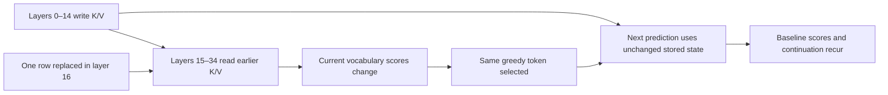

# A recorded contribution transplant — November 7, 2026

The first intervention changed the connected computation and the current
vocabulary scores, but changed **no generated tokens in any of four donor
runs**. It repaired neither failing continuation. All six no-change/self-copy
controls reproduced their baselines exactly.

The investigation also exposed a limitation in the intervention choice. Gemma
4 E2B creates K/V entries in layers 0–14; layers 15–34 reuse earlier caches.
The selected attention contribution was in layer 16, downstream of every K/V
writer. Its changed signal reached the output scores, but the greedy token
remained unchanged. From the next prediction onward, every vocabulary-score
hash matched the baseline again. This is an architectural explanation for the
short-lived effect, not evidence that the model restored a physics pattern.

The persistence route should have been checked when selecting the intervention.
This experiment qualifies a way to transplant and follow a real contribution;
it does not establish an effective lever for the later bookkeeping failure.

This is the authorized external llama.cpp BF16 research arm. No training,
checkpoint editing, production QGRE changes or factory UI changes occurred.
All layer and prediction indices below are zero-based.

## The observable target

The original block pair differs only in the destination climb, 1 m versus 3 m.
Both correctly calculate initial kinetic energy 54 J, downhill gain 30 J,
energy before friction 84 J, then 60 J after the 24 J loss.

| Recipient | Correct available / required / verdict | Recorded baseline |
| --- | --- | --- |
| 1 m climb, `block-base` | 60 J / 30 J / YES | Correct numerical chain and final triple; top/bottom prose labels are reversed |
| 3 m climb, `block-changed` | 60 J / 90 J / NO | 60 J / **120 J** / NO; it incorrectly adds the earlier descent to the final climb |

The generated histories share 253 tokens. Decisions 233 and 234 emit the two
digits of `60`; decision 235 is the first prediction after that full number.
That point was selected from the ordinary response before examining candidate
vectors. The first divergent output is decision 253, where the response restates
the different destination height. These emitted steps locate observable behavior;
they are not assumed to expose faithful internal reasoning.

At prediction 235, one normalized attention-output row, `attn_post_norm-16`,
was replaced with the corresponding row recorded in the paired execution.
The recipient retained its own prompt, generated prefix, residual operand and
all other state. The same replacement was tested at prediction 0 as an early
control, in both directions. A self-copy accompanied every donor arm, and a
no-intervention run qualified each recipient.

The layer-16 choice followed the earlier exploratory observation in
[the BF16 study](../../physics-trace-bf16/run/REPORT.md). That observation identified contextual
change in a connected segment, not a physics-specific component. A whole
recorded contribution was transplanted: no weight value, semantic direction,
output score or selected token was invented or optimized.

## The additional numerical variants

Two more pairs were declared before running. Neither qualified for this
same-history intervention. They remain in the evidence and were not replaced
with additional questions until a desired case appeared.

| Pair | Correct available energy | Required energy, base / changed | Shared generated prefix | Observation |
| --- | ---: | ---: | ---: | --- |
| 2 kg, speed 6 m/s, loss 16 J | 40 J | 20 / 60 J | 18 tokens | Base gets initial kinetic energy wrong, later has 2 J, and hits the token cap; changed has the correct final triple but inconsistent descent accounting |
| 4 kg, speed 4 m/s, loss 12 J | 60 J | 40 / 80 J | 88 tokens | Both final triples are correct; changed nevertheless makes an extra 40 J subtraction and derives an incorrect speed |

Both pairs diverge before a shared correct available-energy result. The original
pair is therefore the only eligible pair out of three considered. There is no
claim of successful replication across numerical variants. Full texts and
separate numerical/explanation assessments are retained in
the baseline assessment
and eligibility decisions.

## What the swaps changed

| Recipient | Swap time | Difference in substituted branch, relative to recipient branch | Changed vocabulary-score decisions | Final answer |
| --- | --- | ---: | ---: | --- |
| Correct 1 m case | After 60 J, prediction 235 | 1.777% | Exactly 235 | Unchanged: 60 / 30 / YES |
| Correct 1 m case | First prediction, 0 | 2.939% | Exactly 0 | Unchanged: 60 / 30 / YES |
| Failing 3 m case | After 60 J, prediction 235 | 1.776% | Exactly 235 | Unchanged: 60 / 120 / NO |
| Failing 3 m case | First prediction, 0 | 2.940% | Exactly 0 | Unchanged: 60 / 120 / NO |

All 1,860 donor-run decisions selected the same tokens as their respective
baselines, including the end-of-generation token. Across the four runs, only the
four directly affected decisions had different full-vocabulary score hashes.
No donor-number copying, numerical repair, worsening of the correct answer,
new truncation or new incoherence occurred.

For the intended repair direction at prediction 235, the injected difference
is visible in the real downstream calculation:

| Recorded boundary | Difference from the unmodified recipient, relative L2 |
| --- | ---: |
| Layer 15 exit, preceding residual | Exactly zero |
| Substituted normalized attention branch 16 | 1.7761% |
| Native attention addition 16 | 0.5605% |
| Layer 16 exit | 0.6164% |
| Layer 17 exit | 0.5449% |
| Layer 34 exit | 0.0471% |
| Final normalized state | 0.1038% |
| Each retained boundary at prediction 236 | Byte-identical to baseline |

Each percentage uses the baseline vector at that particular boundary as its
denominator; these are not percentages of knowledge or retained information.
The complete intermediate progression, absolute differences, source graph IDs
and byte offsets are in each run's `connected-change.json`. The progression is
not assumed monotonic. The primary swap changed the winning token's score from
23.81477 to 23.80984, while its lead over the second candidate remained about
18.08. It still emitted the formatting token space/backslash following `60`.

This establishes a real within-prediction causal effect of the substituted
branch. It does not identify a capability-specific trace, explain the physical
mistake, or show that the transplanted contribution encodes successful reasoning.
The donor and recipient also differ in destination height, so their entire
branch difference cannot be attributed exclusively to success versus failure.

## Why the effect did not continue

The live model metadata reports 35 layers and 20 shared-KV layers. The actual
recorded graph contains K/V producers only at layers 0–14. The runtime cache
log reports later sliding-window layers reusing layer 13, and later full-attention
layers reusing layer 14. Layer 16 itself reuses layer 13.

The pinned native source agrees: `gemma4.cpp` sets the number of K/V-producing
layers to total layers minus shared layers (lines 7–10), builds K/V only when
`has_kv` is true (216–241), and otherwise uses existing cache entries (242–246).
`llama-hparams.cpp:274–285` defines that producer boundary. The inspected source
matches the immutable engine commit used by this experiment.

The resulting dependency is:

The snapshot collector does not dump runtime cache-slot contents. The claim
about persistence rests on the actual graph, model configuration, cache reuse
log and native implementation, together with the exact next-prediction and
future-score observations. It is not a claim to have compared cache bytes.
This standalone run has no speculative assistant or separate recurrent hidden
state carrying the layer-16 activation into the next prediction.

A different selected token could have changed the future. None did. Therefore,
the absence of later repair here does not test whether an earlier contribution
that changes stored context could affect the failure. It also does not refute
the residual-trace hypothesis. The placement gave this one-time change only a
narrow route into later behavior, and that route was not taken.

## Instrument qualification and evidence

The original observer's ordinary/capture runs matched all **2,555 decisions**
for the four new questions, including complete vocabulary-score hashes. The new
instrument's six no-change/self-copy controls matched **2,790 decisions**,
all score hashes and all retained paired boundaries.

Every donor arm matched its recipient's prompt, incoming contribution, and all
pre-intervention tokens/scores. Exactly one row was replaced. The instrument
read back the whole target tensor to verify the replacement and unchanged
surrounding bytes. It then verified that the actual native ADD consumed that
branch with the original residual, with zero arithmetic discrepancy. Upstream
retained boundaries were unchanged. All observed donor continuations stayed
on their baseline histories, so the paired comparisons remain aligned.

The retained scope is the affected prediction and next prediction, including
all layer exits and selected attention/FF/per-layer-input boundaries at layers
12–16. At prediction 0, the prefill recording also includes prompt positions.
All decisions retain complete-logit hashes and top-eight scores. Hashes establish
equality; they do not reconstruct a complete probability distribution. Fused
attention internals, individual weight contributions and runtime KV-slot
lineage remain unrecorded.

The run reused the BF16 checkpoint and immutable native engine from the prior
study: RTX 5080, greedy decoding, 768-token cap, context 2048, batch 128,
microbatch 32, eight CPU threads, flash attention and the same disabled-fusion
setting. Settings were not tuned after observing outcomes. The source extracts,
plans, all responses, before/after vectors, provenance, comparisons and command
exit results are linked from
[the evidence index](EVIDENCE-INDEX.md).

## Consequence for the next experiment

The current layer-16 intervention is useful as a one-prediction control. A probe
of later bookkeeping should follow the earlier connected trace into the
K/V-producing region, choose a contribution before the relevant cache write,
and record that changed write and its later read. The same recipient-value,
self-copy, reverse-direction and shared-history requirements should remain.

This is a proposed next experiment, not a completed one. The declared four donor
arms are finished; no additional layer search, repeated intervention, weight edit
or training was performed after their negative behavioral result.
