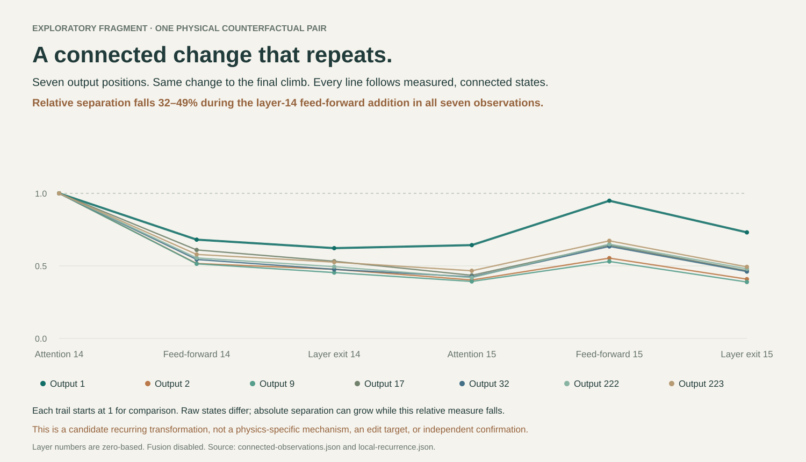
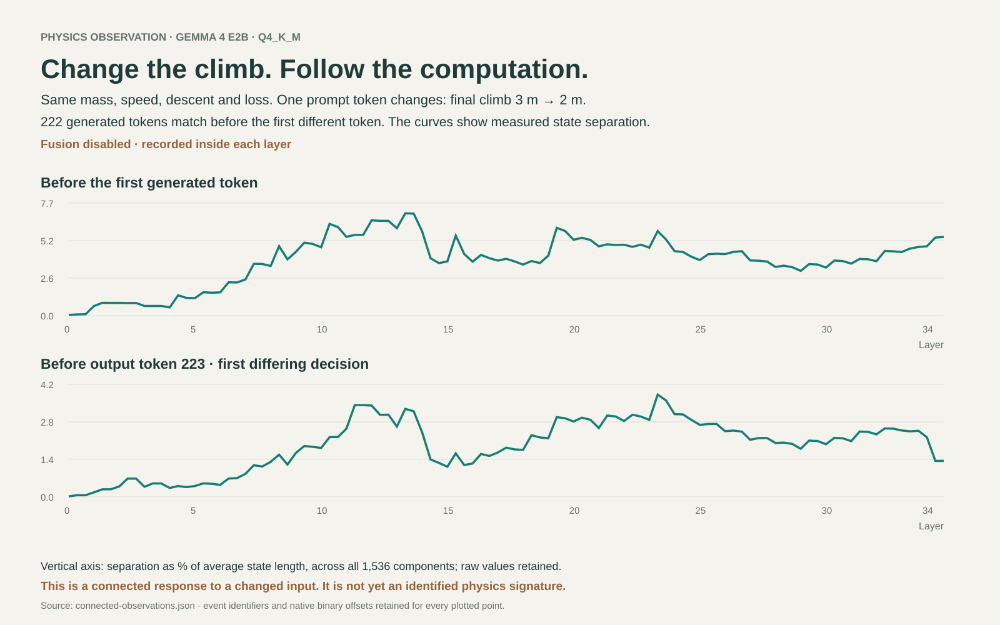

# Physics observation pilot — November 6, 2026

We ran the proposed capability-focused pilot on the existing Gemma 4 E2B
Q4_K_M checkpoint with the local llama.cpp fork. The pilot exposes recurring
descent-energy mistakes and supplies connected observations through prefill and
generation. It has **not identified a shared physics-capability signature or an
edit to the model**. A partial recurring influence remains the research target;
no complete or exclusive physics function is required.

The evidence directory is
[`runs/legs/gemma4-e2b/physics-trace-2026-11-06`](.).
The current definition of the research target is in
RESIDUAL-TRACE-HANDOFF.md.

## What we asked

Six mechanical situations each have an original wording, a paraphrase, and a
changed final climb height that reverses the correct verdict: 18 prompts.
Every situation requires a connected energy progression: initial motion,
gravitational gain during descent, dissipation, and the final climb. The prompt
does not provide the answer or the energy formula.

These 18 prompts were tried in three response formats. These are repeated
presentations of the same situations, not 54 independent physical problems.

| Server pilot format | Correct YES/NO verdict | Reached output limit | Interpretation |
| --- | ---: | ---: | --- |
| Verdict first; 256-token cap | 9/18 | 18/18 | Every answer begins NO; no completed solutions |
| Calculation before verdict; 768-token cap | 11/18 | 1/18 | Most responses omit the requested numerical calculation |
| Explicit numerical calculation; 768-token cap | 6/18 | 10/18 | One complete correct calculation; one correct quantitative progression cut off before verdict |

No prompt was truncated. The numerical-response set was manually assessed from
the full recorded text and checked by an independent reader. Its six correct
verdicts are not six correct physical calculations.

The clearest complete success is the coaster paraphrase: 40 J initial kinetic
energy + 100 J descent gain − 15 J loss = 125 J available; 150 J required;
therefore NO. The block paraphrase correctly reaches 60 J available and 30 J
required, but is cut off during its final comparison.

A recurring failure subtracts the gravitational gain during descent. Another
omits that gain entirely. Several responses notice the resulting contradiction,
reinterpret the starting point, and repeat the error. Some of these still give
the correct NO verdict. This is a useful behavioral target, not yet a localized
neural mechanism.

## What we recorded

The new external native recorder retains prompt and generated-token positions,
operation/source identities, native tensor types, intermediate values at selected
boundaries, and full vocabulary scores at every generation decision. It retains
the actual mixed GGUF formats; it does not read packed four-bit codes as wider
weight values. Float32 intermediate snapshots are the values produced by this
llama.cpp execution, not a conversion of the checkpoint to a different precision.

Four selected cases have detailed captures: coaster original, paraphrase, changed
height, and block paraphrase. The selection is purposeful, based on the earlier
behavioral contrasts, and is not an unbiased success-rate sample.

The detailed captures contain 1,773,640 tensor events and 25,919,299,584 bytes of
intermediate tensor data. This includes 16 empty output tensors at prefill
positions for which no output was requested. Every nonempty recorded tensor has
position metadata. The analysis checks graph references, contiguous binary
offsets and file sizes. At 26 selected output decisions, it verifies 1,820 actual
attention/feed-forward additions against their recorded operands; all agree with
the native float32 addition. Finiteness is checked for inspected state vectors
and all compared vocabulary scores, not claimed for every stored scalar.

Those are connected recorded transformations. They are not a declaration that
every operation or every weight's individual causal contribution was captured.
Flash-attention internals, individual scalar products, mutable KV-slot provenance,
and some backend-copy links remain unobserved. The graph retains those gaps.

## The observer changes execution unless qualified

Requesting intermediate tensors splits the backend graph. In the default fused
configuration, the detailed observer changes numerical scores. On the two
32-token qualification prompts, all generated tokens still match, but the maximum
score differences are approximately 3.183 and 2.622. Saving the data adds no
further difference relative to the same observation boundaries without saving.

Using the engine's existing process-local `GGML_CUDA_DISABLE_FUSION=1` setting
gives exact ordinary/sham/capture agreement on that qualification. The four full
detailed captures also exactly match their ordinary unfused counterparts:
768, 704, 768, and 520 generated decisions, respectively. All 723,517,440 compared
vocabulary scores are finite and identical.

This qualifies the unfused research execution. It does not make it numerically
equivalent to default execution. The earlier successful coaster calculation does
not recur here: the unfused paraphrase omits the descent gain and says 25 J rather
than 125 J. The block paraphrase similarly says 30 J rather than 60 J. Both give
correct verdicts for incorrect reasons. The other two captured responses are
incomplete and contain incorrect physics.

A coarser observer records layer exits while retaining default fusion. Its
ordinary/sham/capture qualification also has exactly matching scores on both
32-token cases. Its four full 768-token captures then exactly match their ordinary
default-fusion counterparts, including all 805,306,368 vocabulary scores. These
coarser captures add 111,312 events and 831,535,104 tensor bytes. All four native
default responses reach the limit and contain incorrect physics; none reproduces
the earlier complete server success.

The standalone native runner and the earlier server also produce different long
completions with the same prompt token IDs and greedy settings. That entry-point
difference remains unresolved. No native capture is labeled as a replay of a
server completion merely because its prompt matches. Assess every captured
completion in its own execution setting.

## What we can inspect now

In the unfused coaster pair, changing only one prompt token—the final climb from
3 m to 2 m—leaves the first 222 generated tokens identical. The corresponding
internal states differ. The comparison follows those differences through the
actual connected attention additions, feed-forward additions, and subsequent
layer transformations, while the generated histories are still the same.
The first differing token is a formatting/wording choice, not an identified point
where the physics becomes wrong. The default native pair shares only five
generated tokens. Comparisons after output histories diverge would also include
the effects of those different histories.

An exploratory recurring segment is visible in this pair. Across all seven
sampled decisions, relative state separation falls by 32–49% during the
feed-forward addition in layer 14 (zero-based). Of the 35 layer feed-forward
additions examined, layer 14 is the only one with this direction of change at all
seven sampled decisions. The following layer's feed-forward addition increases
relative separation at all seven. This is a repeatable local progression of
changes along recorded computation, rather than a similarity between isolated
weights.

These are seven positions in one prompt pair, selected before inspecting this
local recurrence, not seven independent physical situations. The segment itself
was noticed during analysis. Relative separation can decrease while absolute
separation increases because the state length also changes; this is not evidence
that information was erased. The fragment is worth following across additional
physics uses and neighboring transformations. Its participation may be shared
with other capabilities. No physical role or safe edit has been established.
The default-fusion coarse observations also show a relative decrease from the
layer-13 exit to the layer-14 exit at all four inspected shared-prefix decisions.
That observation cannot resolve which internal addition contributes, and it is
still the same physical prompt pair rather than an independent task.

The figure shows separation between two recorded states relative to their average
length, using all 1,536 components. Raw distances, event identities and binary
offsets are retained. It is a viewing statistic, not a geometric shape recovered
from the model. It does not establish which portion of the difference implements
physics, nor that similar-looking curves across tokens have the same cause.

The accompanying connected-observations files preserve representative generation
points, their text context, the successive measured changes, and a concrete
operation/source graph. Other view coordinates in those files are explicitly
marked as display projections; they are not discovered capability coordinates.

## What this pilot changes about the next experiment

We have a repeatable behavioral departure to investigate: how the descent is
carried into the later energy calculation. We also have a recorder whose effects
can be measured, and observed paths through both prompt processing and generated
answers. We still need multiple reliably observed successful applications and
comparisons that separate this physical contribution from shared arithmetic and
language computation. We can investigate a useful fragment without recovering a
complete physics signature.

BF16 is a possible next comparison, not a completed arm. It would use the same
source model version, prompt tokenization, inference entry point, decoding and
observation settings, with each precision assessed independently before comparing
their traces. The current results do not establish that quantization caused the
physical mistakes.

No training, parameter edit, BF16 download, or production engine change was made.
The external recorder and analysis sources are preserved with provenance in the
evidence directory and in the external workspace's local research directory. The raw captures are
research artifacts; they have not been imported into the factory's replay UI.
