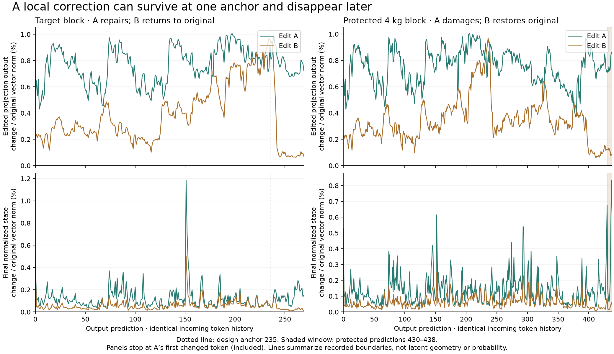

# Following the edit across contexts

Completed November 7, 2026 (CT). Native llama.cpp, Gemma 4 E2B BF16, greedy generation, RTX 5080 (PCI device 0). This is the authorized external weight-editing research arm, separate from production QGRE. No gradient training or runtime activation replacement was used.

**The selective edit did not meet its declared goal.** It restored the damaged 4 kg answer, but also removed the original block repair. One new disc calculation improved. The recordings reveal a useful distinction: two saved edits can produce very similar changes at their design input while behaving differently later in the same response.

## What was completed

1. Completed native captures for the existing edit, A, covering repaired block, repaired sled, preserved block, and damaged 4 kg block.
2. Froze A and evaluated 24 new physics prompts plus four arithmetic and four language controls.
3. Declared and tested exactly one new saved-weight candidate, B, against the previous 28 prompts and eight separately declared confirmation cases.
4. Recorded B on the target and protected cases, qualified the captures against ordinary execution, and added the connected four-case A comparison to Decode Machine.

The object of interest remains the connected transformation of information through many weights. These observations concern partial, context-dependent influence. Individual tensor values, equal magnitudes, and visually similar disconnected vectors are not treated as the capability.

## A: four connected outcomes

Each capture reproduces its ordinary execution's generated tokens and complete-vocabulary score hashes. The paired captures have identical prompt token IDs. The projection is a recorded `MUL_MAT` whose operands are the captured `kqv_out-16` and `blk.16.attn_output.weight`; its incoming vector is exactly unchanged on all paired predictions.

The retained stages are input → projection → normalized contribution → layer 16 exit → layer 24 exit → layer 34 exit → final normalization. The longer intervals summarize intervening computation; they are not single direct edges or an exhaustive per-weight causal decomposition.

| Case | Original → A: available / required / verdict | Shared tokens | Eligible matched predictions |
| --- | --- | ---: | ---: |
| Target block | 60 / 120 / NO → 60 / 90 / NO | 269 | 270 |
| Sled | 0 / 40 / NO → 80 / 40 / YES | 33 | 34 |
| Preserved block | 60 / 30 / YES → identical continuation | 450 | 450 |
| 4 kg block | 60 / 80 / NO → 60 / 40 / YES | 438 | 439 |

There are **1,193 eligible matched predictions**. The first differing prediction is included because its incoming history is still identical. Internals after the emitted-token divergence are not compared as matched inputs. Complete continuations remain available separately. The 4 kg original final triple is correct, but its intermediate energy calculations already contain errors; restoring it does not restore a wholly correct chain.

At the first differing prediction, projection changes are 0.7212% for the target, 0.8620% for the sled, and 0.8609% for the 4 kg case. Their final-normalization changes are 0.1522%, 0.1807%, and 0.6315%, respectively. Thus a similar initial effect need not develop the same way downstream. The preserved block's last prediction changes internally despite identical emitted tokens. Percentages use the original vector norm at each boundary, not one common physical unit or a probability denominator.

Source: [connected-traces.json](connected-traces.json), including graph/event/offset joins and all four continuations.

## A: fresh family results

The 24 physics prompts are three wordings of eight energy situations, with varied quantities and absolute/reference-height formulations. They are correlated variants, not 24 independent capability discoveries. All prompts and budgets were declared before this family ran.

| Measure | Original | A |
| --- | ---: | ---: |
| Correct numerical chain and conclusion, physics | 1 / 24 | 1 / 24 |
| Correct literal YES/NO, physics | 4 / 24 | 5 / 24 |
| Physics responses hitting 768-token cap | 17 / 24 | 17 / 24 |
| Correct arithmetic controls | 4 / 4 | 4 / 4 |
| Correct language controls | 4 / 4 | 4 / 4 |

All eight control continuations are token-identical. Overall, 22/32 continuations are identical. The extra correct literal verdict comes from a wagon response whose derivation still includes `640 − 600 + 500 = 140`; it is not a new correct numerical chain. The one correct physics chain reaches a clear verbal conclusion before its cap, but does not finish the requested literal YES/NO line. Both facts are explicit in [family-assessment.json](family-assessment.json) and [the complete responses](RESPONSES.md).

This family does not demonstrate broad transfer of A's numerical repair. The high cap rate also limits what was observed; unseen continuation is never assumed correct.

## B: a persistent edit with protected contexts

[The prediction](SELECTIVE-PLAN.md) was written before generation. B keeps A's output correction direction at target prediction 235, but changes which incoming contexts receive it. The input key removes the span of the original 4 kg case's nine consecutive incoming vectors at predictions 430–438, immediately before and including A's first changed token. It is then normalized to keep the intended correction at the design input:

`q = x − projection_onto_protected_span(x)`

`ΔW = (y_success − y_failure) qᵀ / (qᵀx)`

The nine-vector window was chosen from conditioning-only inspection of one, five and nine vectors. There was no behavioral candidate sweep. The donor difference includes the source prompts' differing climb heights and is not an isolated physics direction.

B is a separate saved GGUF, made from the original. The editor rounds the modified entries into native BF16 before inference. It changes **312,037 of 3,145,728** values in `blk.16.attn_output.weight`, **317,283 bytes**, with realized matrix-norm change **0.0445366%**. A's corresponding change is 0.0296559%. Full-file comparison covers **9,311,304,896 bytes** and finds **zero changes outside the selected tensor**. Original and A checkpoints are retained.

After storage rounding, B's actual matrix-difference action on the nine protected original inputs is **8.78%–17.88% of A's**, median 15.97%. The ideal null does not survive exactly in BF16. This fixed-input arithmetic check is separate from native generation. [Stored protection](stored-protection.json), [saved edit](selective-applied.json).

| Declared requirement | Observed B result | Result |
| --- | --- | --- |
| Keep target repair: 60 / 90 / NO | 60 / 120 / NO, all 480 tokens identical to original failure | Failed |
| Restore 4 kg final triple: 60 / 80 / NO | All 665 tokens identical to original | Passed for final triple; old calculation errors remain |
| Preserve all seven previously correct numerical chains | All seven token-identical to original | Passed |

**The conjunction fails.** Sled transfer also disappears: B returns to original 0 / 40 / NO. The preserved block remains identical. Twenty-five of the previous 28 continuations are identical to original; the three that change remain capped failures.

| Population | Numerical chain + conclusion: original → B | Correct literal verdict: original → B | Caps: original → B |
| --- | --- | --- | --- |
| Previous 28, including six arithmetic controls | 7 → 7 | 16 → 16 | 9 → 9 |
| Eight new confirmation cases | 3 → 4 | 3 → 4 | 4 → 3 |

Six of eight confirmation continuations are identical. The new gain is `confirm-disc-4`: B computes **64 + 20 − 24 = 60 J**, compares it with **80 J**, and finishes with **NO**. The original computed 0 J and reached a correct verbal NO before its cap. B still contains a confused generic energy equation and unexplained reference-height switch. This is a numerical repair, not a fully corrected physical explanation. The gain is reported separately; it does not rescue the failed primary prediction.

[Candidate assessment](candidate-assessment.json) · [all candidate responses](CANDIDATE-RESPONSES.md) · [independent review](REVIEW.md).

## What the native traces add

B's target and 4 kg captures exactly match their ordinary executions in tokens and complete-score hashes. Because both continuations match original in full, **480 + 665 = 1,145** predictions have shared incoming histories. All 1,145 score hashes change despite unchanged selected tokens. The edited projection's incoming vector remains exactly unchanged at each matched prediction.

| Matched observation | A: projection change | B: projection change | A: final-normalization change | B: final-normalization change |
| --- | ---: | ---: | ---: | ---: |
| Target design anchor, prediction 235 | 0.9191% | 0.9548% | 0.0580% | 0.0587% |
| Target at A's first changed token, prediction 269 | 0.7212% | 0.06969% | 0.1522% | 0.01264% |
| 4 kg at A's first changed token, prediction 438 | 0.8609% | 0.08501% | 0.6315% | 0.04206% |

The fixed-input editor diagnostic also places both rounded edits similarly close to the donor output at the anchor: remaining distance 44.4103% for A and 44.1693% for B. Nevertheless, B does not retain A's target repair. **Matching a correction at one recorded input is insufficient to preserve its evolution across contexts.** The data do not isolate prediction 269 as the sole cause: these are persistent edits, with changed scores throughout generation and memory effects that can accumulate downstream.

[SVG for publication](../../../../publications/figures/exports/physics-edit-footprint-2026-11-07--two-edits.svg) · [native B trace data](candidate-traces.json).

## Connected inspection view

Open [Weight edit traces](http://127.0.0.1:4318/?trace=block-changed). The app shows A's four outcomes together, paired energy bars, measured propagation across seven boundaries, common incoming text, selected alternatives, full continuations, and graph/source provenance. The graph's vertical scale is fixed across the four cases. Its schematic positions are not a recovered latent geometry. Playback uses a chosen total duration; shared-history eligibility bounds the scrubber.

This view covers A's four-case footprint. B's comparison and new-family scores are in this report and the standalone figure, not silently mixed into A's UI dataset. Evidence downloads retain case → prediction → boundary → graph node/event/tensor-offset relationships and checkpoint identities.

App checks: `bun run test` — 73 passed, exit 0; `bun run build` — exit 0 after final layout changes. Analysis checks: `node --test code/physics-edit-footprint-2026-11-07/trace.test.mjs` — three passed, exit 0. Browser checks cover four cases, scrubber endpoints, duration/play/pause, preserved-history navigation and provenance. Final screenshots were independently reviewed at 3840×2050, 1440×1000 and 390×844 requested viewports. The served 8,192,666-byte evidence payload matches the on-disk export exactly. The browser automation did not expose a completed download event, so a user Downloads-folder save is not claimed verified.

## Interpretation and next question

We now have observed repair, interference, and a deliberate change to the edit's context sensitivity, all in actual stored weights and connected native traces. The protection worked locally and behaviorally for the selected final triple, but the target repair depended on more than its anchor match. This is useful partial evidence about context-dependent influence, without establishing a complete physics function or a unique recovered geometry.

The next proposed experiment would retain several connected target contexts while protecting several observed failure contexts, with a fresh prediction and untouched prompts. That is a proposal, not an additional candidate run in this study. It should test whether preserving the development of the correction improves selectivity, rather than simply making the anchor correction stronger.

The small confirmation set, correlated formulations, high truncation rates, mixed prose quality, and absence of a matched-size random-edit arm limit wider conclusions. The earlier FF14/FF15 recurrence is upstream of this edit and is not itself repaired or causally isolated here.
