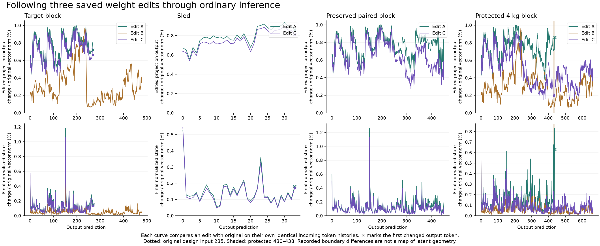

# Preserving connected portions of a saved weight edit

November 7, 2026 CT. Native llama.cpp, Gemma4 E2B BF16. Candidate C is a real saved checkpoint edit; no training or activation replacement.

**The predeclared selective-repair prediction passed.** C retains both of A's numerical repairs, restores the original final answer on the 4 kg case that A damaged, and preserves all seven originally correct numerical chains in the old 28 suite. The target and sled continuations match A exactly; the protected 4 kg continuation matches original exactly. These are known development cases. The four fresh physics questions did not improve.

This is a concrete advance in controlling the observed edit. It does not establish general safe capability editing or the whole distributed-trace hypothesis. We preserved context-dependent transformations inferred from connected observations, rather than assigning semantic meaning to isolated scalar weights. The study does not search for or demonstrate a complete physics function.

## What was predicted and what happened

[The plan](PLAN.md) and the new questions were frozen before C generation; one candidate was constructed, without a post-outcome parameter sweep.

| Declared condition | Result under C | Outcome |
| --- | --- | --- |
| Keep target numerical repair | 54+30−24=60 J available; 90 J required; NO. All 413 tokens identical to A | Passed |
| Keep sled numerical repair | 50+40−10=80 J available; 40 J required; YES. All 533 tokens identical to A | Passed |
| Restore protected 4 kg final triple | 60/80/NO. All 665 tokens identical to original | Passed |
| Keep all 7 originally correct numerical chains | All 7 remain correct, with complete continuations token-identical to original | Passed |

The protected 4 kg response already contained intermediate calculation errors before A. Restoring its correct final triple does not make that response a correct numerical chain. The target and sled still have erroneous state labels or prose. Numerical repair is not a fully correct explanation.

For comparison, B restored the protected final triple but lost both target and sled repairs. C combines their preservation with protection in the measured cases. C also retains B's disc4 numerical repair on a previously evaluated prompt; that is development evidence, not a second unseen confirmation.

## The saved change

Let W be original and D=A−W the actual rounded BF16 matrix difference from the first edit. We selected all 270 original input contexts through A's first changed target token, plus all 34 through its first changed sled token. The nine protected inputs are the same original4kg predictions 430–438 used for B.

We constructed the smallest matrix correction E satisfying EX=0 on those 304 positive inputs and EZ=DZ on the nine protected inputs, before rounding. C is native BF16_RNE(A−E). Thus the design retains A's action along the observed positive passages while subtracting its action on the protected contexts. It is an analytical weight calculation using recorded transformations, not a gradient-training run.

All 304 positive columns are independent under the declared tolerance. Protected directions remain independent after projection outside their span; residual fractions range 0.03870–0.21020. Dual-constraint residuals are below 1e-14. [Construction](constraints.json), [conditioning](design.json), [pre-run review](PRE-RUN-REVIEW.md).

Native storage makes the constraints approximate. Across the 304 positive fixed inputs, C's action differs from A by 6.53%–18.98%, median 9.85%. The nine protected fixed inputs retain 24.41%–27.08% of A's action norm. These are CPU equation diagnostics on actual rounded matrix bytes; ordinary native inference separately determines the behavior.

| Stored matrix measurement | C |
| --- | ---: |
| Tensor | blk.16.attn_output.weight |
| Shape | 2,048 inputs × 1,536 outputs |
| Changed stored values | 523,778 / 3,145,728 |
| Changed bytes | 533,239 |
| Realized change norm / original matrix norm | 0.0948835% |
| Declared ceiling | 4×A's realized norm, about 0.118624% |
| Original checkpoint bytes compared | 9,311,304,896 |
| Changed bytes outside selected tensor | 0 |

C's matrix change is about 3.2×A's. The successful tradeoff therefore does not show equal-sized edits or a minimum behavioral edit. The stored-value count is not a count of neurons with exclusive physics meaning. Original, A and B remain separate and unchanged. C model SHA256: `c62cec0e716d573400947704bfd837034b9eda755637526c152a33fc54e561ec`. [Applied edit](native-applied.json).

## Every population, without pooling incompatible scores

| Population | Numerical chains + conclusion, original→C | Correct literal verdict, original→C | Caps, original→C | Whole continuations identical |
| --- | --- | --- | --- | --- |
| Old 28, including 6 arithmetic cases | 7/28→9/28 | 16/28→17/28 | 9→9 | 19/28 |
| Previous 8 confirmation questions, now development | 3/8→4/8 | 3/8→4/8 | 4→3 | 5/8 |
| Earlier controls: 4 arithmetic + 4 language | Arithmetic 4/4→4/4; language 4/4→4/4 | Arithmetic 4/4→4/4 | 0→0 | 8/8 |
| Fresh 8: 4 physics + 2 arithmetic + 2 language | Physics 1/4→1/4; arithmetic 2/2→2/2; language 2/2→2/2 | Physics 3/4→3/4; arithmetic 2/2→2/2 | 1→1 | 7/8 |

Total: 52 candidate generations plus 8 new original baselines. Earlier original baselines are retained by source and verified content hash. C has 39/52 token-identical continuations and 13 caps. The fresh changed response is new-sledge-1; it still subtracts the downhill energy and caps. New-trolley-4 correctly compares 70 J with 80 J, but ends by incorrectly labeling the 10 J deficit as required-from-foot energy; it is not counted as a complete correct calculation. No completion beyond any cap is presumed.

The disc2 numerical chain reaches a correct verbal conclusion before its cap; this counts as a numerical-chain conclusion but not a literal YES. Disc4 now correctly computes 64−24+20=60 J, compares 80 J, explicitly answers NO and finishes. Its preceding generic equation and unexplained datum switch remain wrong. All changed responses and fresh originals were read in full. [Judgments](response-judgments.json), [assessment](assessment.json), [all responses](RESPONSES.md).

Ordinary comparisons have 20326 eligible matched predictions; every corresponding complete-vocabulary score hash changed. Matching emitted text therefore does not imply unchanged computation. These repeated decisions are not independent capability tests.

## Connected native capture

All four C captures reproduce ordinary C generation exactly on **2,061 decisions**, both selected tokens and complete-vocabulary score hashes. The projection's recorded MUL_MAT operands join to the selected stored matrix and the recorded incoming vector. The incoming projection vectors are exactly identical in each eligible pair.

| Case | Original/A eligible decisions | Original/C eligible decisions | A/C eligible decisions |
| --- | ---: | ---: | ---: |
| Target block | 270 | 270 | 413 |
| Sled | 34 | 34 | 533 |
| Preserved paired block | 450 | 450 | 450 |
| Protected 4 kg block | 439 | 665 | 439 |
| Total for each pairing | 1,193 | 1,419 | 1,835 |

The first differing output decision is included because its incoming history is still shared. Nothing afterward is forced into correspondence. The A/C comparison can continue through the complete target and sled answers because those two arms emit identical tokens. These are related comparisons of the same four cases, not independent samples to add into a larger accuracy denominator.

| Native observation | A projection change | C projection change | A final-state change | C final-state change |
| --- | ---: | ---: | ---: | ---: |
| Target design input 235 | 0.9191% | 0.8858% | 0.0580% | 0.0574% |
| Target first changed output 269 | 0.7212% | 0.6623% | 0.1522% | 0.1379% |
| Sled first changed output 33 | 0.8620% | 0.8115% | 0.1807% | 0.1722% |
| Protected 4 kg, A's changed output 438 | 0.8609% | 0.2132% | 0.6315% | 0.1088% |

Each percentage divides the boundary-vector difference by that boundary's original vector norm. The final state is `result_norm`. B's target projection change at 269 was only 0.06969%, while C retains 0.6623%. C therefore preserves much more of the observed later correction than B, while reducing the protected effect.

The native score margins give another view of the same decisions. These are logits, not probabilities or direct score edits:

| Shared-history decision; first token minus second | Original | A | B | C |
| --- | ---: | ---: | ---: | ---: |
| Target 269: gained − reached | −0.006393 | +0.008394 | −0.006218 | +0.008017 |
| Sled 33: math opener − newline | −0.000462 | +0.003975 | −0.001232 | +0.004982 |
| Protected 438: energy − total | +0.022707 | −0.007727 | +0.021198 | +0.015263 |

C keeps the repaired branches' selections and restores the protected branch's original selection. These near-tie decisions also limit robustness claims: the result is under fixed greedy settings, not a sampling or phrasing stability result. The words mark the first visible divergence; the experiment does not isolate them as the mechanism or treat their identity as the edit target.

[Full connected traces](connected-traces.json), [decision sources](decision-margins.json), [SVG](../../../../publications/figures/exports/physics-connected-edit-2026-11-07--three-edits.svg), [PNG](../../../../publications/figures/exports/physics-connected-edit-2026-11-07--three-edits.png).

The chart is a summary of measured changes along recorded computation. It is not an image of recovered latent geometry.

## What this says about the research direction

The practical question from the previous round was whether a repair's development across several contexts could be preserved while its action near a known damaging branch was reduced. C answers yes for the two repairs and protected response used here, after actual BF16 rounding and ordinary inference. That supports the usefulness of connected observations for designing selective persistent edits.

The selected passages are partial observations from known cases, not the full trace of a capability. The result does not identify all necessary contributors, establish an exclusive physics representation, or demonstrate arbitrary capability repair. The primary suite has no matched-size random-edit comparison. The twelve additional arithmetic/language controls are narrow, and no larger language benchmark was run. The four new physics cases give no numerical gain; generalization remains an open experimental question.

Marcos's possible connection to faster or more effective RL remains a future hypothesis. This study performs no RL investigation or training and makes no claim about training-time savings.

## Reproduction and review

[Commands](COMMANDS.md), [binary/source identities](provenance.json), [evidence map](EVIDENCE-INDEX.md). Constraint tests passed 3/3; native editor compiled successfully. Its unchanged default mode reproduced A's stored tensor hash. Ordinary C run completed with exit 0. Capture run, connected qualification, response comparison, assessment and figure generation completed with exit 0. The independent response review found no material errors; it verified all 104 response bodies, 52 prompt/budget pairs, 44 reused baseline hashes and judgments, and all declared outcomes. Final trace review is recorded in [REVIEW.md](REVIEW.md).
