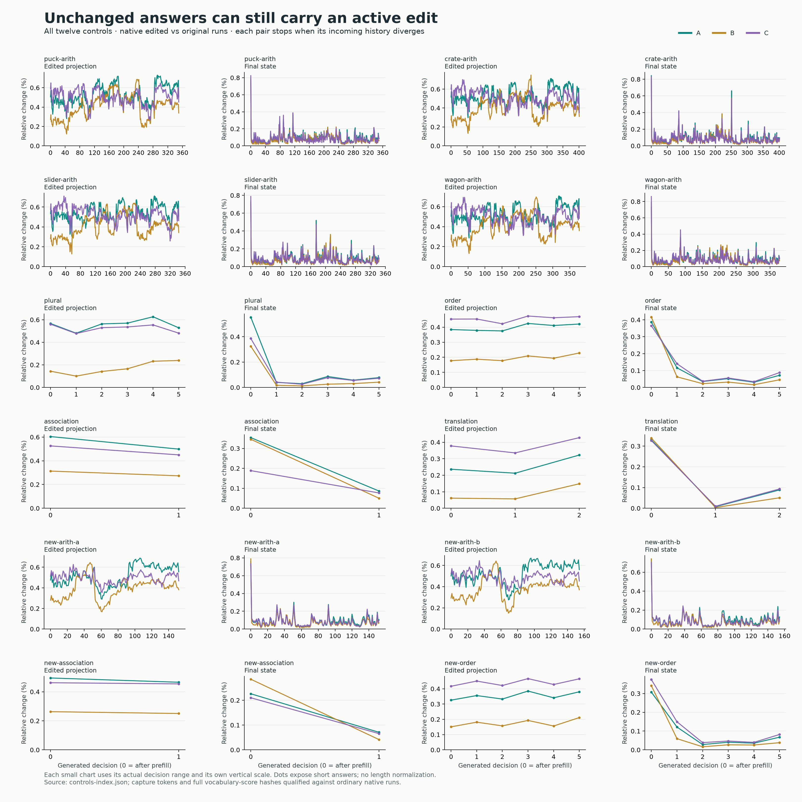
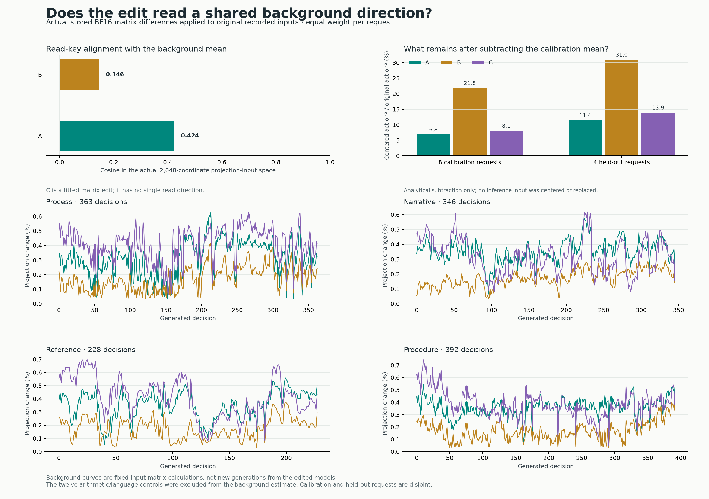
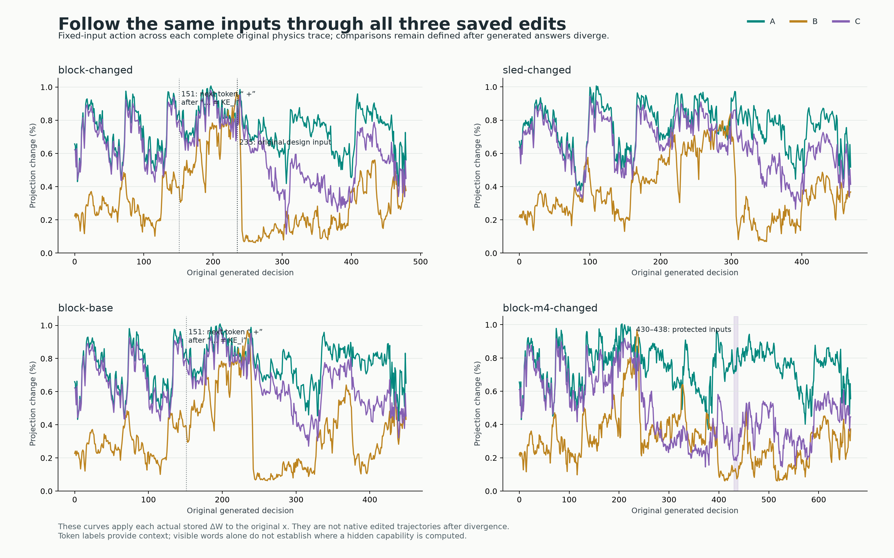
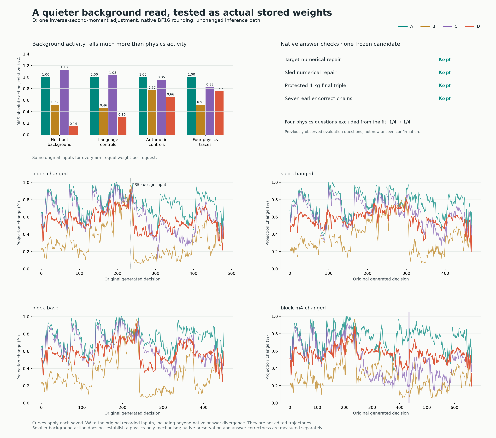

# Background sensitivity of the saved physics edits

## Question and result of the background check

Marcos identified the broad activity of A and C in the four physics traces and proposed checking whether they read a common background direction. The completed background check supports that concern. The actual saved edits act on every arithmetic/language control, and a shared mean component dominates their action on the longer background requests. This does not, by itself, establish why the four fresh physics questions failed to improve.

| Measurement | A | B | C |
| --- | ---: | ---: | ---: |
| Intended read-key cosine with calibration mean | 0.423637 | 0.146152 | No single read key |
| Mean component / total squared action, eight calibration requests | 93.1599% | 78.1742% | 91.9102% |
| Same fraction, token-weighted sensitivity | 93.1130% | 77.9040% | 91.9185% |
| Squared action remaining after analytical subtraction of calibration mean, four held-out requests | 11.3931% | 30.9511% | 13.9278% |
| Range of per-request median native projection changes, six arithmetic controls | 0.5009–0.5376% | 0.4018–0.4290% | 0.4977–0.5213% |
| Same range, six language controls | 0.2364–0.5646% | 0.0613–0.2934% | 0.3776–0.5328% |

All twelve control continuations are token-identical to original under A, B and C. Every comparable full vocabulary-score hash changes. The forty-eight captures match their own ordinary runs on all 7,236 decisions, including selected tokens and complete-score hashes. This shows broad internal activity without an answer change on these controls. B is quieter, but is not generally inactive away from physics.

The background set contains eight calibration and four held-out requests, covering procedures, editing, structured reference text and narratives. All twelve ordinary answers ended before their 512-token caps. Their captures qualify on all 4,001 decisions: 2,672 calibration and 1,329 held out. These are twelve requests, not 4,001 independent examples. The controls do not fit the background statistics.

## What is measured

Each saved tensor is read as native BF16 and checked against its recorded tensor SHA. The difference D is the actual stored edited matrix minus the original. The inputs x are the recorded 2,048-coordinate `kqv_out-16` vectors that actually enter `blk.16.attn_output.weight`; the residual stream has a different width and is not substituted for them.

For the primary estimate, each request has equal weight, and every generated decision within a request has equal weight. We compute the calibration mean mu and the uncentered second moment M = E[xx^T]. Actual action decomposes as D x = D mu + D(x − mu). On calibration, the mean cross term vanishes. On held-out data the cross term is retained; the calibration mean-action squared can exceed held-out total action squared, so that ratio is not presented as explained variance. The figure instead shows the squared action remaining after analytical centering.

Analytical centering changes no inference input and implements no model repair. The later candidate changes only stored weights. Background curves are fixed-input matrix calculations on original recorded inputs; they are not edited-background generations. Native controls are separately recorded comparisons on common incoming histories, with exact projection-input equality checked. The largest native-versus-fixed-input discrepancy in the relative projection metric is 0.000004662 as a ratio, or 0.0004662 percentage points.

## Corrections to the initial interpretation

A was constructed from one captured input/output pair, not an average over 100 prompts. B projected that key away from nine protected inputs. C preserved actual stored A action on 304 connected inputs while suppressing nine protected inputs. The background diagnosis can still hold even though the proposed averaging origin does not describe these edits.

The shared final-state spike at prediction 151 occurs in both block cases before the next token ` +`, immediately after the expression ending `Total Energy before rough section ... = KE_i`. It coincides with the energy-addition expression. Its position did not establish that it was irrelevant formatting. Also, generated decision zero follows the full prompt prefill; it is not a point before the model has encountered the physical problem.

Visible prose or numbers do not by themselves label where hidden physics computation happens. A quieter background footprint is a measurable improvement in selectivity, but it does not alone isolate a capability. The complete fixed-input physics curves expose these distinctions:

## Stored candidate D: quieter background, preserved repairs

The predeclared mean criterion passed. The one fixed inverse-second-moment adjustment and its native BF16 dry calculation are documented in CANDIDATE-PLAN.md and the independent review. D was saved as a separate BF16 checkpoint, then used by ordinary native inference. The complete 9,311,304,896-byte model comparison found zero changes outside the selected tensor. Its full SHA is `5c33e46d51db6d2ac8dc1551078663ab97b7eebc67b51b493f9bdea8b2f805f2`.

The intended read is q = (M + lambda I)^−1 k, normalized so q^T k = 1, with lambda = 0.05 trace(M) / 2048. The actual lambda is 0.00921740181182784. The same donor output difference and original design input used for A remain fixed. No controls, held-out background requests or other physics contexts fit this read key. There was one candidate, with no ridge, amplitude or layer sweep.

| Stored edit measurement | Result |
| --- | ---: |
| Changed BF16 values | 331,670 / 3,145,728 |
| Realized edit norm / original matrix norm | 0.0452194% |
| Size relative to A | 1.5248× |
| Size relative to C | 0.4766× |
| Remaining donor distance at the design input | 47.6960% (A: 44.4103%) |
| Original-input projection change at design decision 235 | 0.91851% (A: 0.91914%) |

### Actual rounded footprint

| Population | D's RMS absolute projection action relative to A | Reduction |
| --- | ---: | ---: |
| Four held-out background requests | 0.14497× | 85.50% |
| Six language controls | 0.30348× | 69.65% |
| Six arithmetic controls | 0.65523× | 34.48% |
| Four complete original physics traces | 0.76460× | 23.54% |

Each row uses equal weight per request, on the same original inputs for every edit. The background reduction is also 87.16% relative to C. This is the action of the **actual BF16-rounded matrix**, not merely the intended rank-one update or its nearly orthogonal read key. D's remaining mean component is nonzero after rounding. The twelve background requests were not rerun under D; their edited action is a fixed-input calculation, with native answer and propagation checks supplied by the physics/control runs.

### Native behavioral outcomes

The declared behavioral conjunction passes. D retains the target's 60 / 90 / NO numerical repair and the sled's 80 / 40 / YES repair. The protected 4 kg response is token-identical to original, ending 60 / 80 / NO; its pre-existing intermediate errors remain. All seven originally correct numerical chains are token-identical to original. All twelve extra arithmetic/language controls are correct and token-identical to original.

| Evaluation population | Original → D | Comparison with C |
| --- | --- | --- |
| Original 28 | Numerical chains 7→9; explicit verdicts 16→17; caps 9→9 | Same aggregate correctness as C; 20/28 original continuations retained |
| Previous eight confirmation questions | Numerical chains 3→4; verdicts 3→4; caps 4→3 | Same aggregate correctness as C |
| Four physics questions introduced with C, excluded from D's fit | Numerical chains 1/4→1/4; verdicts 3/4→3/4 | No gain |
| Twelve additional arithmetic/language controls | All correct; all original continuations retained | Same as C |

Across all 52 cases, D has 40 original-identical continuations, 50 C-identical continuations, and 13 caps. Full-response judgments inherit a prior reviewed result only when the **same case's full-content SHA matches**; the new sled continuation was read in full and given an explicit saved judgment. Correct numerical calculations and literal final verdicts do not imply flawless explanatory prose. The previously fresh questions are not new unseen confirmation in this round.

All sixteen D captures qualify against ordinary D execution on 3,807 decisions, with identical selected tokens and full vocabulary-score hashes. Original/D internal comparisons cover 3,228 common-history decisions: 1,419 across the four physics cases and 1,809 across controls. Input vectors at the edited projection match exactly throughout those comparisons. At target decision 269, native projection change is 0.45033% and final-state change 0.09337%; at protected decision 438 they are 0.61852% and 0.44508%. These are vector-norm changes, not token probabilities. The protected continuation still remains exactly original.

[All twelve native controls including D](../../../../publications/figures/exports/physics-background-sensitivity-2026-11-07--four-edit-controls.png) and native D qualification summary retain the complete comparison.

### What this resolves, and what it leaves open

The shared background action was real and substantially removable while preserving the measured repairs and controls. D offers the same observed aggregate correctness as C with a smaller parameter change and much quieter general-text action.

The stronger proposed outcome has **not** been reached: D still acts throughout much of the physics trajectories, including prose and the first generated decision. It also remains active on arithmetic controls. We have improved separation from general text, not isolated only the positions where energy is computed or recovered a physics-only mechanism.

The four excluded physics questions still do not improve. Therefore the evidence does not establish broad background action as the sole or sufficient explanation for the earlier generalization failure. This intervention also changes the read along more than its mean component, so it is not an isolated causal subtraction of one factor. The useful next question is which connected input transformations distinguish the repaired cases from the remaining failures **after** background sensitivity is accounted for. This study does not scale the model or investigate RL savings.

ROME's [primary input-vector implementation](https://github.com/kmeng01/rome/blob/main/rome/compute_u.py) uses the inverse of an uncentered second moment gathered by [its layer-statistics code](https://github.com/kmeng01/rome/blob/main/rome/layer_stats.py). We adapt that input-side idea to this attention projection, with a small designed background set and a fixed ridge. This is not the complete ROME factual-MLP method, and inverse-second-moment adjustment does not guarantee exclusive activation on physics.

## Evidence

- Frozen plan, prepared design, run commands.
- All background requests and responses.
- Native control summary, qualified control traces.
- Background analysis, background source positions, physics source positions.
- D's actual stored action, complete response assessment, all original/D responses, native D traces, checkpoint and instrument provenance.
- Sources and spike context, acquisition review.

Raw tensor captures and original-input exports remain local under this study. Code and publication figures are in the research collection. No production QGRE change, training, inference-time activation replacement, or model scaling is part of this study.
