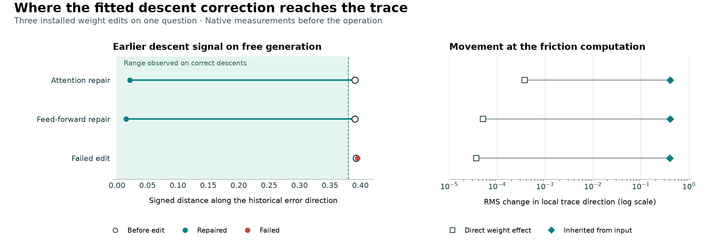
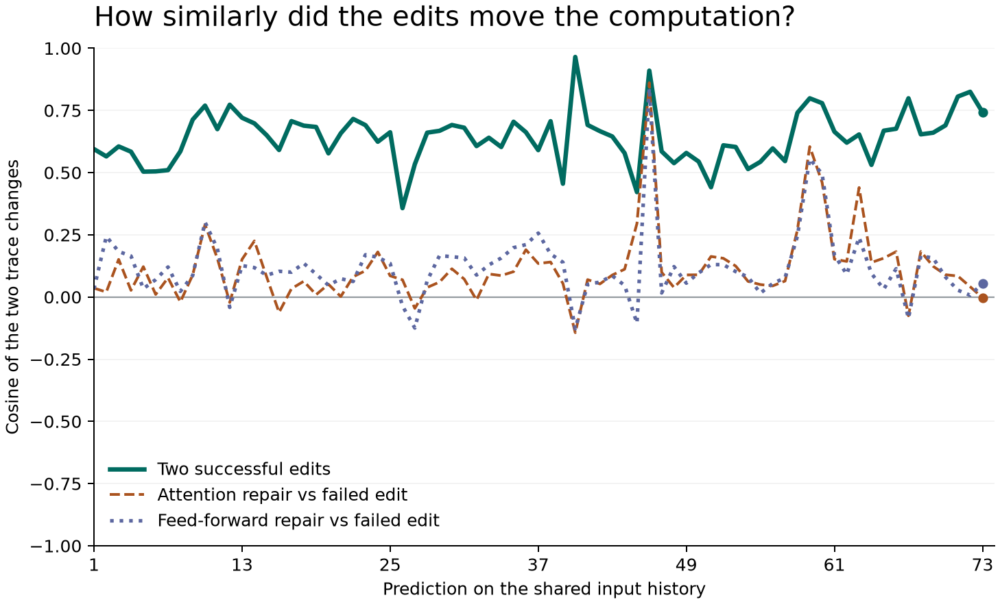

# Did the same-input comparison distinguish the three edits?

Both known successful weight edits repaired descent and preserved the later friction subtraction. Their local weight effects had opposite signs at the aligned descent phase. The projected update left descent wrong and friction correct. The expected sign of the mean local change therefore fails as a common training signal on these cases.

## Native comparison

For each query, take the original local map evaluated on its original state, the same old map on the edited state, and the edited map on that same edited state. Subtract the last two to obtain the direct change due to local weights. Subtract the first from the second to obtain the change received from upstream. Each map receives the inputs needed for its operation, including the edited attention context. The previous and edited responses come from their own natural generations. The comparison used one fitted 91 J problem. The two successful transplants began at the same earlier trained checkpoint and changed different families. The failed edit began at original Gemma.

The primary score compares the squared distance of the native unit turn to the frozen correct trace under edited weights with that under original weights at the same edited input. A negative value means closer. The mean retains all 105 merges and all tied correspondence rows. Friction was independently judged on the energy supplied to it.

| Physical edit | Descent score | Friction score | Outside tolerance at descent | Outside tolerance at friction | Bottom energy | Energy after friction |
| --- | ---: | ---: | ---: | ---: | ---: | ---: |
| Attention repair | +1.8107e-06 | +5.601e-07 | 0/105 | 0/105 | 104 J | 91 J |
| Feed-forward repair | -4.1641e-08 | -3.9674e-08 | 0/105 | 0/105 | 104 J | 91 J |
| Failed projected edit | +1.944e-07 | +7.8218e-09 | 3/105 | 8/105 | 24 J | 11 J |

For the failed edit eight friction merges exceeded the allowance even though it applied the 13 J loss correctly. On both successful edits the uncapped direct signs remained opposite at the subsequent numeric restatement. The RMS inherited motion at the friction prechoice was 1,066 times the direct motion for the attention repair and 7,907 times for the feed-forward repair. These are ratios of vector norms. They do not partition a percentage of the total. [Common-scale result](result.json) · [Successful forward controls](../same-input-successful-repairs/README.md) · [Failed forward controls](../same-input-failed-repair/readout/result.json).

## Where the known signal moved

At the historical feed-forward readout the highest projection among the original correct witnesses was 0.38018. Both repaired natural descents crossed into that range, ending at 0.02112 and 0.01510. The failed edit moved from 0.39329 to 0.39538 and stayed above it. On the attention repair the whole −0.37002 change arrived through the incoming state. On the feed-forward repair the direct contribution was +0.00000070, with inherited movement of −0.37604. This identifies a place to observe the effect of a repair on this question. Two interventions improving the same readout can act on different upstream computations. It does not establish that the local weights at the readout should receive the correction. [Projected components](historical-direction.json).

## Correspondence and limits

The reference phase names were assigned on a known successful answer. Mapping its stages onto each query used the recorded computation. An independent read of each response supplied the arithmetic and the timing comparison. Both complete-history and prefix-only mapping landed on the separately audited descent and friction prechoices for all three edited answers. Prefix-only matching skipped the symbolic friction phase on the two starting models. It recovered the later numerical friction phase on both. The previous reordered-case miss and the independence of a new evaluation set remain relevant. [Registered rows](registration.json) · [Prefix timing](prefix-timing.json) · [Source for the original task and directional axis](historical-direction-declaration.json).

All inputs to these interventions were existing checkpoint weights and trajectories. No fresh training update was chosen or installed by this comparison. The native replays tested what the previously installed physical edits did. The worker bound the source model, edited bytes, exact history and incoming operands. All three positive-arm natural acquisitions reproduced the original residual bytes. Each successful mixed replay matched 90,228 operand hashes. Both failed-arm endpoint controls were bitwise exact, and its same-weight restoring replay matched all 172 inspected boundaries. Some valid descent routes or correct friction operations can have different internal traces. The controls do not establish generalization.

The small-record observer carries the primary per-arm metrics under `native.same_input_descent_signed` and `native.same_input_friction_signed`. The record uses steps 0, 1 and 2 for attention, feed-forward and failed edit respectively. [MLflow comparison](http://127.0.0.1:5000/#/experiments/6/runs/c9c28bbe70cb4261b1e86811a0433133).

## Before the generated histories differed

The five native weight states received identical inputs for 73 successive predictions. At the final shared input the model states made three different next choices. Those choices first entered the computation as inputs at native event 245. The historical descent readout was 67 positions later. This gives a window in which the weights could affect the measured computation but differences between consumed inputs could not.

At each shared event we measured the direction change from the normalized incoming residual to the normalized outgoing residual at every merge. We subtracted the same quantity at each edit’s starting weights. Each resulting vector contains 105 merges × 1,536 coordinates. The comparison below is the cosine between two such displacements. The whole-prefix column concatenates all 73 vectors before normalizing. The figure normalizes separately at each prediction. No answer word or sign enters the calculation. [Declared calculation](prefix-effect-declaration.json) · [All per-event values](prefix-effects.json).

| Edits compared | Whole shared prefix | Final shared input |
| --- | ---: | ---: |
| Attention repair and feed-forward repair | 0.7364 | 0.7427 |
| Attention repair and failed edit | 0.2991 | −0.0031 |
| Feed-forward repair and failed edit | 0.2006 | 0.0541 |

The repair pair ranked first at all 73 events. Its smallest lead over either failed pairing at one event was 0.0486. The earlier repair study already reported the cosine between the two successes. Here the failed physical edit supplies a comparison, and the per-event ordering shows when the distinction appears. The ordering held at every event when all endpoints were measured from the early checkpoint and again when all were measured from original Gemma. Shared centering checks the subtraction convention. The two positive edits still share a donor lineage, and the failed edit was smaller and began at another checkpoint. Eli independently reconstructed the cosines from native residuals, agreeing within 1.4 × 10⁻¹³. [Common-origin control](common-origin-effects.json) · [Independent review](../../../../records/retrospectives/2026-11-18-same-input-operation-review.md).

Crossing weights with the history each model had generated explains the distinction from the later observation. On the old, wrong history, the repaired attention and feed-forward weights scored 0.38309 and 0.38982, both above the historical correct bound of 0.38018. On the repaired history, the early weights scored 0.01447, inside the bound. The weights that produced the repaired histories can therefore be causally important while the historical scalar largely reads back a route already taken. [Crossed histories and native controls](../same-input-crossed-success-histories/README.md).

The 73 predictions came from one fitted question. A failing descent and a valid friction subtraction occurred in the same original computation. This comparison alone cannot establish which operation the early directional change represents. A prospective test should freeze the trace comparison, register by computation on unseen problems including reordered operations, and score candidates before seeing their outcomes. Compare repairs with unsuccessful edits of comparable size, including edits from the same starting weights, then independently judge descent and friction in free regeneration. This tests whether the direction adds a usable selection signal for the existing loop.

In MLflow the three metrics beginning with `native.shared_prefix.` and ending with a pair of edit names give the 73-event curves. The suffixes `.all_common_decode` and `.last_shared_input` give their summary readings. The parent run also carries both plots and both numerical prefix records. [Verified metric and artifact inventory](mlflow.json) · [MLflow comparison](http://127.0.0.1:5000/#/experiments/6/runs/c9c28bbe70cb4261b1e86811a0433133).
